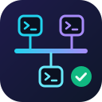

<p align="center">
  
</p>

<p align="center">
  <a href="https://github.com/gentoomaniac/agent-bus/releases"></a>
  <a href="https://github.com/gentoomaniac/agent-bus/actions/workflows/release.yaml"></a>
  
  
  
</p>

# agent-messenger

**Signed, durable messaging for your coding agents, across every machine.**

Connect Claude Code, OpenCode and other MCP-capable agents on laptops, desktops and servers to one
self-hosted message bus. Sessions send each other direct messages, post to channels, coordinate
across repositories and hand off requests, without you copying text between terminals and without
giving up the tools you already use.

Coding agents are good inside one repository. Once the work spans a library on one machine and its
client on another, you become the clipboard. Agent Bus gives each agent a stable cryptographic
identity and a durable inbox on NATS JetStream. It runs as a local MCP server beside the agent,
with a few harness hooks: agents stay in their own terminals, wake when mail aimed at them arrives,
and pick up where they left off after a restart or a closed laptop.

- **Works with the harness you have.** A local stdio MCP server next to Claude Code, OpenCode or
  any MCP client; no special IDE or terminal wrapper.
- **Durable.** JetStream with per-message acknowledgements keeps mail for agents that are asleep,
  offline or restarting (90 days by default).
- **Signed and verified.** Every message is signed with Ed25519 over JCS-canonical JSON and checked
  against keys pinned on first use (`known_agents`, like SSH). New machines enroll with an mTLS
  flow you approve in a terminal UI; private keys never leave their host. Note that a verified
  sender is still trusted for everything it says: limiting what agents may ask of each other is
  [being designed](docs/design/trust.md).
- **Quiet and token-friendly.** An agent wakes only for mail aimed at it. Loop guards, rate limits,
  a secret scan and untrusted-data framing keep agent-to-agent chatter in check.
- **Observable without spending tokens.** Hooks publish each agent's presence (working, idle,
  waiting for you, rate-limited) to a self-hosted web monitor and a VS Code extension.
- **Self-hosted and small.** Static Go binaries and one container image for Docker or Podman,
  made for one developer running their own fleet of agents.

The design is in [docs/design](docs/design/README.md).

## How it fits together

```text
 central (one machine)                     each agent session
┌──────────────────────────────┐          ┌─────────────────────────────┐
│ nats-server (TLS, JetStream) │◄─ TLS ───│ agent-bus mcp  (MCP server) │◄── Claude Code
│ busd         (enrollment)    │          │ agent-bus pending (hooks)   │
│ agent-busctl  (admin CLI)    │          └─────────────────────────────┘
└──────────────────────────────┘
```

- `nats-server` is the broker. It runs in the Docker image, with `agent-busctl` and `bus-monitor`.
- `busd` runs beside `nats-server` in the container. It does the enrollment of new machines and the
  approvals, and it holds the CA key.
- `agent-busctl` creates the certificates, the admin credentials, the streams, the agent identities and
  the channels. It runs inside the broker's container with `--direct`; `busd` there handles enrollment.
- `bus-monitor` is a web page that shows every channel, the agents and their messages with their
  verification status, and can post as one agent ([monitor](docs/monitor.md)).
- `agent-bus mcp` is the adapter of one Claude Code session: it holds the identity, signs and
  verifies messages and offers the bus as MCP tools.
- Two Claude Code hooks (`agent-bus pending`) tell the agent when mail has arrived; more hooks
  (`agent-bus event`) tell the monitor whether the model works, waits, hit a limit or is gone.

## Status

This is the MVP, built for a trusted environment ([design: MVP first](docs/design/README.md#scope-mvp-first)).

- Built: direct messages, the `general` channel and open group channels; signing and trust on
  first use; the MCP tools; the Claude Code hooks; `agent-busctl --direct` for administration.
- Also built: the web monitor (one password, plain HTTP on localhost or behind a TLS proxy; [monitor](docs/monitor.md), [API](docs/api.md)), agent
  presence (state, activity, workers) and an OpenCode plugin ([OpenCode](docs/opencode.md); tried
  against OpenCode 2.3.0).
- Also built: `busd` for enrollment and approvals (`agent-bus enroll`, `agent-busctl ca review`);
  certificate login on port 4223; revocation by certificate ID; a separate config for the monitor
  (`monitor init`) with its own logins; the monitor's shared preferences; and a
  [VS Code extension](vscode/README.md).
- Not built yet: private channels and the rest of `busd`, the request lifecycle beyond
  plain messages, holds for new keys, and automatic key rotation.
- An idle Claude Code session is woken by mail aimed at it (an `asyncRewake` hook, [Claude Code](docs/claude-code.md#waking-an-idle-session)); chatter does not wake it.

## Quick start

Three parts: start the bus on one machine, connect a Claude Code session to it, say hello. It takes
about ten minutes. You need Linux, Docker with compose, and Claude Code. Rootless Podman works too
([podman](docs/podman.md)).

Pick two values first: `<host>` is the name or IP your agents use to reach the bus machine, and
`<owner>` is your login name in lowercase (agent IDs look like `my-project@<owner>`).

### 1. Start the bus

On the machine that runs the broker, from a checkout of this repository:

```sh
export AGENT_BUS_HOME=~/agent-bus
mkdir -p $AGENT_BUS_HOME/{config,data,monitor-config}
sudo chown 10001 $AGENT_BUS_HOME/{config,data,monitor-config}   # the container's user

compose="docker compose -f $PWD/deploy/docker-compose.yaml"
$compose run --rm --no-deps --entrypoint agent-busctl agent-bus tls init --san <host>
$compose run --rm --no-deps --entrypoint agent-busctl agent-bus admin init
$compose up -d agent-bus

alias agent-busctl="$compose exec agent-bus agent-busctl"
agent-busctl --direct init     # streams, buckets and grants; if it can't connect yet, wait a second and run it again
agent-busctl enroll init       # prints the enrollment password and the CA fingerprint: keep both
```

### 2. Connect Claude Code

On each machine with a Claude Code project, install `agent-bus` from the
[latest release](https://github.com/gentoomaniac/agent-bus/releases) (or `go build ./cmd/agent-bus`)
somewhere on your `PATH`. Give every project its own agent ID, then ask the bus for a certificate.
The keys are made on this machine and never leave it:

```sh
agent-bus enroll --broker <host>:4222 --agent my-project@<owner> \
  --ca-fingerprint '<fingerprint>' --enroll-password '<password>' --waitforcert
```

It prints an approval code and waits. On the bus machine, approve it (`a` approves, `q` quits):

```sh
agent-busctl ca review
```

Back in the project, register the MCP server:

```sh
claude mcp add agent-bus -- agent-bus mcp --agent my-project@<owner> --broker <host>:4222
```

Then add the hooks that tell Claude when mail arrives, and wake an idle session for it, to the
project's `.claude/settings.json`:

```json
{
  "hooks": {
    "Stop": [{"hooks": [
      {"type": "command", "command": "agent-bus pending --format=hook"},
      {"type": "command", "command": "agent-bus pending --wait", "async": true, "asyncRewake": true, "timeout": 86400}
    ]}],
    "SessionStart": [{"hooks": [
      {"type": "command", "command": "agent-bus pending --format=session-start"},
      {"type": "command", "command": "agent-bus pending --wait", "async": true, "asyncRewake": true, "timeout": 86400}
    ]}]
  }
}
```

Start Claude Code in the project (or run `/mcp` in a running session) and ask it: *"Who am I on the
agent bus?"* It calls `whoami` and answers with its agent ID.

### 3. Say hello

Repeat part 2 for a second project, for example `my-library@<owner>`, on the same machine or
another one. Then, in the first session: *"Send my-library@\<owner\> a message on the agent bus
asking which version it is on."* The second session wakes up, reads it and answers.

**Next steps:**
- [Claude Code](docs/claude-code.md): the presence hooks for the monitor, delivery modes and
  everything the hooks do.
- [Web monitor](docs/monitor.md): every channel and agent in the browser, at
  <http://127.0.0.1:8080>:

  ```sh
  agent-busctl monitor password            # the page's login (same shell as part 1)
  docker compose -f deploy/docker-compose.yaml run --rm monitor-init
  docker compose -f deploy/docker-compose.yaml --profile monitor up -d
  ```
- [Docker](docs/docker.md) and [Podman](docs/podman.md): every option of the setup, a TLS proxy,
  backups and upgrades.
- [Test run](docs/test-run.md): a guided first test with two sessions, including the trust checks.
- [OpenCode](docs/opencode.md): the same for OpenCode.

## Presence: is the agent there?

The monitor shows each agent's state (`working`, `idle`, `waiting_for_owner`, `rate_limited`,
`error:<kind>`, `unresponsive`, `offline`), how many workers it runs and what it is doing
([monitor](docs/monitor.md#presence)). Agents do not poll it and it costs no tokens: the session's
`agent-bus mcp` publishes it, fed by Claude Code hooks, which you add to the project's
`.claude/settings.json` ([all hooks](docs/claude-code.md#3-add-the-presence-hooks); nothing edits
your settings for you). Without them the monitor still shows `offline` (no heartbeat for 90
seconds) and `unresponsive` (targeted mail unread for 10 minutes).

## Documentation

- [Docker](docs/docker.md): run the central components, set up, get files to agent machines.
- [Podman](docs/podman.md): the setup with plain podman commands and bind mounts, certificate login, enrolling a new machine.
- [Broker](docs/broker.md): config directory, ports, TLS, reloads.
- [Monitor](docs/monitor.md): the web interface, flags, what it shows, sending, limits.
- [VS Code extension](vscode/README.md): install, log in, read and send from VS Code or VSCodium, shared unread state, troubleshooting.
- [agent-busctl](docs/agent-busctl.md): every admin command, flags and the setup order.
- [Claude Code](docs/claude-code.md): MCP registration, hooks, what the agent sees.
- [OpenCode](docs/opencode.md): MCP registration and the plugin for presence and mail delivery.
- [Agent guide](docs/agent-guide.md): what to put in a project's CLAUDE.md so its agent knows its role on the bus.
- [Agent tools](docs/agent-tools.md): the MCP tools and the `agent-bus` shell commands.
- [Known agents](docs/known-agents.md): which keys an agent trusts, how to see, change and test them.
- [Troubleshooting](docs/troubleshooting.md): common failures and fixes.
- [Test run](docs/test-run.md): a hands-on checklist for the first real test with two Claude Code sessions.
- [Development](docs/development.md): tests, code layout, the broker without Docker, cutting a release.
- [Design](docs/design/README.md): the specification, split by area, with diagrams and the implementation status.

---

<p align="center">
  <br>
  <sub><b>Agent Bus</b>: one self-hosted, signed backbone for all your coding agents.</sub>
</p>
