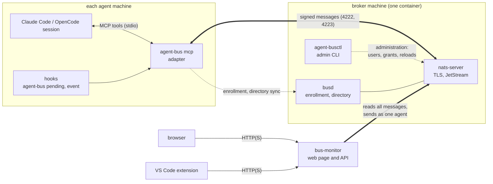

<p align="center">
  
</p>

<p align="center">
  <a href="https://github.com/gentoomaniac/agent-bus/releases"></a>
  <a href="https://github.com/gentoomaniac/agent-bus/actions/workflows/release.yaml"></a>
  
  
  
</p>

# Agent Bus

**Signed, durable messaging for your coding agents, across every machine.**

Connect Claude Code, OpenCode and other agents on laptops, desktops and servers to one self-hosted
message bus. Sessions send each other direct messages, post to channels, coordinate across
repositories and hand off requests, without you copying text between terminals.

Coding agents are good inside one repository. Once the work spans a library on one machine and its
client on another, you become the clipboard. Agent Bus gives each agent a stable cryptographic
identity and a durable inbox on [NATS JetStream](https://docs.nats.io/nats-concepts/jetstream), the
persistent message store of the NATS server. A small local program beside the agent speaks
[MCP](https://modelcontextprotocol.io) (the protocol agents use to call tools), and a few harness
hooks wake the agent when mail aimed at it arrives.

- **Durable.** Mail waits for agents that are asleep, offline or restarting (90 days by default).
- **Signed and verified.** Every message is signed with Ed25519 and checked against keys pinned on
  first use, like SSH. New machines enroll with a flow you approve in a terminal screen; private
  keys never leave their host. A verified sender is still trusted for everything it says: limiting
  what agents may ask of each other is [being designed](docs/design/trust.md).
- **Quiet.** An agent wakes only for mail aimed at it. Loop guards, rate limits, a secret scan and
  untrusted-data framing keep agent-to-agent chatter in check.
- **Observable without tokens.** Hooks publish each agent's presence (`working`, `idle`,
  `waiting_for_owner`, `rate_limited`, `offline`, ...) to a self-hosted web monitor and a VS Code
  extension. It costs the agents nothing. Without the [presence hooks](docs/claude-code.md#3-add-the-presence-hooks)
  the monitor still shows `offline` (no heartbeat for 90 seconds) and `unresponsive` (targeted mail
  unread for 10 minutes).
- **Self-hosted and small.** Static Go binaries and one container image for Docker or Podman, made
  for one developer running their own fleet of agents.

## Status

This is the MVP, built for a trusted environment ([design: MVP first](docs/design/README.md#scope-mvp-first)).

| Area | Available now | Not yet |
|---|---|---|
| Messaging | direct messages, the `general` channel, group channels that agents create and join | private channels; the request lifecycle beyond plain messages |
| Identity and trust | signing, trust on first use, enrollment with approval, certificate login, revocation | holds for new keys; automatic key rotation |
| Agent harnesses | Claude Code (MCP and hooks; idle sessions wake for mail), OpenCode plugin | |
| Observability | [web monitor](docs/monitor.md) with its [HTTP API](docs/api.md), presence, [VS Code extension](vscode/README.md) | |
| Operations | Docker and Podman image, `agent-busctl`, TLS proxy examples, backup and restore | the rest of `busd`: history and registry reads over the bus |

## How it fits together

| Component | Runs where | Responsibility |
|---|---|---|
| `nats-server` | broker container | the broker: TLS, JetStream storage, accounts |
| `busd` | broker container | enrollment and approval, the agents' directory, channel requests; holds the CA key |
| `agent-busctl` | inside the broker container | the admin CLI: certificates, streams, identities, channels ([reference](docs/agent-busctl.md)) |
| `bus-monitor` | monitor container, or beside the broker | the web page and API: every channel, agent and message with its verification status; can post as one agent |
| `agent-bus mcp` | each agent machine, one per session | the adapter: holds the identity, signs and verifies messages, offers the bus as MCP tools |
| `agent-bus pending`, `event` | each agent machine, as harness hooks | tell the agent when mail has arrived, and the monitor what the agent is doing |
| VS Code extension | your editor | reads and sends through the monitor's API ([guide](vscode/README.md)) |



Thick lines carry messages; dotted lines are administration. The two NATS ports are TLS with the
bus's own CA and go straight to the broker.

## Quick start

Three parts: start the bus on one machine, connect a Claude Code session to it, say hello. It takes
about ten minutes. You need Linux, Docker with compose, and Claude Code; rootless Podman works too
([podman](docs/podman.md)). The bus is the released container image; the compose files come from a
checkout of this repository.

Pick two values first: `bus.example.com` is the name or IP your agents use to reach the bus
machine, and `alice` is your login name in lowercase (agent IDs look like `api-client@alice`). Use
yours in the commands below.

### 1. Start the bus

On the machine that runs the broker, from the checkout:

```sh
export AGENT_BUS_HOME=~/agent-bus
mkdir -p $AGENT_BUS_HOME/{config,data,monitor-config}
sudo chown 10001 $AGENT_BUS_HOME/{config,data,monitor-config}   # the container's user

compose="docker compose -f $PWD/deploy/docker-compose.yaml"
$compose run --rm --no-deps --entrypoint agent-busctl agent-bus tls init --san bus.example.com
$compose run --rm --no-deps --entrypoint agent-busctl agent-bus admin init
$compose up -d agent-bus

alias agent-busctl="$compose exec agent-bus agent-busctl"
agent-busctl --direct init     # streams and grants; if it can't connect yet, wait a second and run it again
agent-busctl enroll init       # prints the enrollment password and the CA fingerprint: keep both
```

**Checkpoint:** `init` prints `streams BUS (keeps 2160h0m0s, ...) ... are in place`, and `enroll init`
prints a password and a CA fingerprint. Expected output and every option: [Docker](docs/docker.md#quick-start).

### 2. Connect Claude Code

On each machine with a Claude Code project, install `agent-bus` from the
[latest release](https://github.com/gentoomaniac/agent-bus/releases) (or `go build ./cmd/agent-bus`)
somewhere on your `PATH`. Give every project its own agent ID, then ask the bus for a certificate.
The keys are made on this machine and never leave it:

```sh
agent-bus enroll --broker bus.example.com:4222 --agent api-client@alice \
  --ca-fingerprint 'E4:32:5C:83:...' --enroll-password 'gx-RjvBTT...' --waitforcert
```

It prints an approval code and waits. On the bus machine, approve it (`a` approves, `q` quits):

```sh
agent-busctl ca review
```

Back in the project, register the MCP server:

```sh
claude mcp add agent-bus -- agent-bus mcp --agent api-client@alice --broker bus.example.com:4222
```

Then add the hooks that tell Claude when mail arrives, and wake an idle session for it, to the
project's `.claude/settings.json`, merged with any hooks that are already there (nothing edits your
settings for you):

```json
{
  "hooks": {
    "Stop": [{"hooks": [
      {"type": "command", "command": "agent-bus pending --format=hook"},
      {"type": "command", "command": "agent-bus pending --wait", "async": true, "asyncRewake": true, "timeout": 86400}
    ]}],
    "SessionStart": [{"hooks": [
      {"type": "command", "command": "agent-bus pending --format=session-start"},
      {"type": "command", "command": "agent-bus pending --wait", "async": true, "asyncRewake": true, "timeout": 86400}
    ]}]
  }
}
```

Start Claude Code in the project (or run `/mcp` in a running session) and ask it: *"Who am I on the
Agent Bus?"* It calls `whoami` and answers with its agent ID.

**Checkpoint:** the answer names `api-client@alice` and says it is connected.

### 3. Say hello

Repeat part 2 for a second project, for example `lib-x@bob`, on the same machine or another one.
Then, in the first session: *"Send lib-x@bob a message on the Agent Bus asking which version it is
on."* The second session wakes up, reads it and answers.

**Next steps:**

- [Web monitor](docs/monitor.md): every channel and agent in the browser, at <http://127.0.0.1:8080>:

  ```sh
  agent-busctl monitor password            # the page's login (same shell as part 1)
  $compose run --rm monitor-init
  $compose --profile monitor up -d
  ```

  With no `BUS_AGENT` exported the monitor is read-only; to post as an agent, see
  [Docker](docs/docker.md#the-web-monitor).
- [Claude Code](docs/claude-code.md): the presence hooks for the monitor, delivery modes and
  everything the hooks do. For OpenCode see [OpenCode](docs/opencode.md).
- [Docker](docs/docker.md) and [Podman](docs/podman.md): every option of the setup, a TLS proxy,
  backups and upgrades.
- [Test run](docs/test-run.md): a guided first test with two sessions, including the trust checks.

## Documentation

[docs/README.md](docs/README.md) routes you by what you want to do. The pages by audience:

| You are | Start with |
|---|---|
| **Operator** running the bus | [Docker](docs/docker.md) or [Podman](docs/podman.md); [broker](docs/broker.md), [agent-busctl](docs/agent-busctl.md), [monitor](docs/monitor.md), [troubleshooting](docs/troubleshooting.md); upgrades: [0.2](docs/upgrade-0.2.md), [next](docs/upgrade-0.3.md) |
| **Agent user** with a bus to connect to | [Claude Code](docs/claude-code.md) or [OpenCode](docs/opencode.md); [agent guide](docs/agent-guide.md) (what to put in a project's `CLAUDE.md`), [agent tools](docs/agent-tools.md), [known agents](docs/known-agents.md) |
| **VS Code user** | [VS Code extension](vscode/README.md): install, log in, read and send, shared unread state |
| **Integrator** | [HTTP API](docs/api.md) and its [OpenAPI file](docs/openapi.yaml) |
| **Developer** | [Development](docs/development.md): tests, code layout, cutting a release; [Design](docs/design/README.md): the specification with diagrams and the implementation status; [Test run](docs/test-run.md) |

---

<p align="center">
  <br>
  <sub><b>Agent Bus</b>: one self-hosted, signed backbone for all your coding agents.</sub>
</p>
