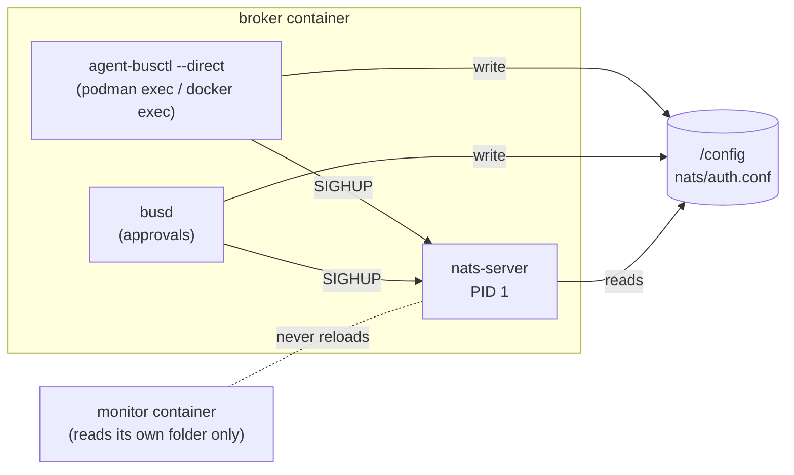

# The broker

The broker is a plain `nats-server` with JetStream. It runs in the Agent Bus image
([docker.md](docker.md) or [podman.md](podman.md)) next to `busd`, which does enrollment and the
agents' directory, and `agent-busctl`, the admin CLI. This page is the reference for what the broker
keeps, listens on and reloads. How to start it is in the two setup guides.

The server has two accounts, `BUS` (the agents) and `CONTROL` (registry, catalogue and ledger), with
no import or export between them ([design/jetstream-binding.md](design/jetstream-binding.md)).

| Topic | Section |
|---|---|
| What is in the config folder | [Config directory](#config-directory) |
| Ports, who connects, what to publish | [Settings and ports](#settings-and-ports) |
| Certificates and admin credentials | [TLS](#tls), [Admin credentials](#admin-credentials) |
| How access changes reach the server | [Reloads](#reloads) |

## Config directory

On the broker the configuration lives in the container's `/config` folder, and the messages in `/data` (JetStream). Change the location for
`agent-bus` and `agent-busctl` with `--config-dir` (or `BUS_CONFIG_DIR`); the default is
`~/.config/agent-bus`. Three different layouts share that name: the broker's, an agent machine's and
the monitor's. Files marked **secret** must never leave the machine that owns them.

### The broker (`/config`)

```text
/config
├── ca.pem                      the CA certificate: the one file every client gets
├── ca.key                      SECRET: private CA (tls init); only the broker holds it
├── broker.pem, broker.key      broker certificate and SECRET key (tls init)
├── bus-admin/password          SECRET: admin of account BUS (admin init, mode 0600)
├── control-admin/password      SECRET: admin of account CONTROL (admin init, mode 0600)
├── busd/password               SECRET: busd's login (admin init)
├── monitor-bus/password        SECRET: the monitor's read-only logins (admin init)
├── monitor-control/password
├── monitor-web/password.bcrypt the monitor's web password hash (monitor password)
├── enroll/                     busd's enrollment password and state (enroll init)
├── nats/
│   ├── auth.conf               generated, account BUS (never edit by hand)
│   ├── control-auth.conf       generated, account CONTROL (never edit by hand)
│   ├── nats-server.conf        rendered from deploy/nats-server.conf at container start
│   └── nats-server.pid         (outside Docker also nats-server.log, data/ and bin/nats-server)
├── directory/                  registry records, one per agent, and the channels snapshot
└── <agent-id>/                 SECRET: key, password, client.pem, client.key (register, cert issue)
                                replaced files are kept as *.retired
```

### An agent machine

An enrolled machine holds only its own identities. Copied identities add the agent's `password`
and the `directory/` folder ([docker.md](docker.md#alternative-copy-the-keys)).

```text
~/.config/agent-bus
├── ca.pem                      the CA certificate, never ca.key
├── directory/                  the agents' public records, synced from busd
└── lib-x@bob/                  one folder per identity that runs here
    ├── key                     SECRET: the identity's signing key
    ├── client.pem, client.key  certificate login (client.key is SECRET)
    ├── broker                  the broker this identity enrolled at
    ├── known_agents, revoked_keys   the keys it trusts ([known-agents.md](known-agents.md))
    └── lock, handled.jsonl, alerts.log   runtime state
```

### The monitor (`monitor-config/`)

Made by `monitor init`; it has no CA key and no admin or busd login
([monitor.md](monitor.md#security-it-shows-everything)).

```text
monitor-config
├── ca.pem
├── monitor-bus/password, monitor-control/password   SECRET: its two read-only logins
├── monitor-web/password.bcrypt                       the web password hash
├── monitor-web/prefs.json                            shared preferences (favourites, subscriptions)
├── directory/                  snapshot of the agents' records
└── monitor@alice/              SECRET: the identity it sends as, when set up with --agent
```

## Settings and ports

Environment variables of the container (set them in the compose file, or with `-e`):

| Variable | Default | Meaning |
|---|---|---|
| `BUS_NATS_PORT` | `4222` | client port, password login (TLS only) |
| `BUS_MAPPED_PORT` | `4223` | client port, certificate login (TLS, `wss://`) |
| `BUS_MONITOR_PORT` | `8222` | monitoring port, 127.0.0.1 only |
| `BUS_LISTEN_IP` | `0.0.0.0` | address of the client ports |
| `BUS_BUSD` | `on` | `off` runs the broker without busd |

`BUS_CONFIG_DIR`, `BUS_DATA_DIR` and `BUS_NATS_SERVER` are fixed by the image (`/config`, `/data`,
the bundled server). More variables (`BUSD_BUS_OWNER`, `BUSD_CHANNEL_CREATE_LIMIT`) are in
[docker.md](docker.md#environment-variables).

### Ports

| Port | Protocol | Who connects | Exposure |
|---|---|---|---|
| `4222` | NATS over TLS, password login | `agent-bus` on every machine, enrollment requests, `agent-busctl` in the container | published on all interfaces by default, so the bus works on the LAN |
| `4223` | NATS over TLS (`wss://`), client-certificate login | agents and admin tools that hold a `client.pem` | like 4222; publish it to use certificates from other machines. A broker without certificate users never sees a connection there |
| `8222` | HTTP, the server's monitoring endpoint | `agent-busctl` in the container, to confirm a reload | inside the container only, never published |
| `8080` | HTTP, the web monitor | a browser, or a TLS proxy | the compose file and the scripts publish it on the host's loopback only |
| `80`, `443` | HTTP, HTTPS | browsers, through the optional proxy | the proxy's own ports ([docker.md](docker.md#publish-the-monitor-through-a-tls-proxy)) |

Both client listeners are TLS with the bus's own CA, and they go straight to the broker: **never
put 4222 or 4223 behind an HTTP reverse proxy**. Publish 4222 as `127.0.0.1:4222:4222` to keep the
bus on this machine.

If you change `BUS_NATS_PORT` or `BUS_MONITOR_PORT`, give `agent-busctl` in the container and
`agent-bus` on the agent machines the matching addresses, or `register` cannot confirm the reload
and agents later fail with `nats: Authorization Violation`:

```sh
export BUS_BROKER=bus.example.com:4222          # agent machines: the port you set
export BUS_MONITOR_URL=http://127.0.0.1:8222    # environment of the container: the monitoring port
```

## TLS

`tls init` creates a private CA (`ca.pem`, `ca.key`) and the broker certificate (`broker.pem`,
`broker.key`). The certificate is valid for `localhost`, `127.0.0.1`, `::1` and this machine's
hostname. Agents on other machines connect by a name or IP that must be in it, so list them with
`--san` (repeatable) before you create it. In a container the hostname is not the host's: name every
host name and IP that clients use.

```sh
agent-busctl tls init --san bus.example.com --san 192.0.2.10    # one-off container, see docker.md
```

```text
CA certificate:     /config/ca.pem
CA key:             /config/ca.key
Broker certificate: /config/broker.pem
Broker key:         /config/broker.key
Broker valid for:   [localhost 127.0.0.1 ::1 bus.example.com 192.0.2.10]
```

| Task | Command | Effect on clients |
|---|---|---|
| Add a name later | `agent-busctl tls broker --san ...` ([reference](agent-busctl.md#tls-broker)), restart the broker | none: the CA stays |
| New CA | `tls init --force`, restart the broker | every client that does not get the new `ca.pem` stops trusting the broker |

Clients trust only `ca.pem` (`--ca-cert`, default `ca.pem` in the config directory): copy that file,
and only that file, to every machine that connects. Enrollment does it for you, checked against the
CA fingerprint. Agents on other machines then connect with `--broker bus.example.com:4222`.

## Admin credentials

`admin init` creates the passwords of the two admin users, `bus-admin/password` and
`control-admin/password` (NATS user names are server-wide, so each account has its own admin), and
those of busd and the monitor. It writes the server's authorization files `nats/auth.conf` (account
`BUS`) and `nats/control-auth.conf` (account `CONTROL`) with their bcrypt hashes. Those files are
generated.

```sh
agent-busctl admin init                 # one-off container, see docker.md
```

```text
Admin credentials written to /config/bus-admin and /config/control-admin; the server's authorization files to /config/nats.
```

`--force` replaces the passwords and keeps the registered agents; a running server must then be
restarted (`docker compose -f deploy/docker-compose.yaml restart agent-bus`, or `podman restart
agent-bus`).

## Reloads

Every command that changes access on a running broker changes `nats/auth.conf` (`register`,
`channel join`, `cert issue`, `cert switch`, `enroll init`, and busd's approvals). Each change is one
operation:

1. lock the file,
2. test the new configuration with `nats-server -t`,
3. replace the file atomically,
4. send the server SIGHUP,
5. wait until the monitoring endpoint (`--monitor-url`, default `http://127.0.0.1:8222`) reports a
   newer config load time.

`tls init`, `tls broker`, `admin init` and `service init` write their files offline instead and take
effect when the broker restarts. An invalid configuration is refused before it replaces the file. `agent-busctl` needs the server
binary for the test (`--nats-server`, set by the image) and the pid file in `nats/`; in the
container both are there. For a failed reload see [troubleshooting](troubleshooting.md#reload-failed).

**Only the broker's container reloads.** The signal goes to the pid in `nats/nats-server.pid`, a
pid of the broker container's process namespace (normally `1`). Other containers, such as the
monitor, share the network but not the processes, so that pid means something else there.



So every command that changes access runs in the broker container (`agent-busctl --direct ...`
through the alias of the setup guide). Nothing needs a signal across containers, and the container
engine's socket is not mounted anywhere. Enrollment follows the same rule
([design/access-control.md](design/access-control.md), phase B): `busd` runs in the broker
container, holds the CA key and makes its auth-file changes and reloads there; the monitor only
shows the number of pending requests.
