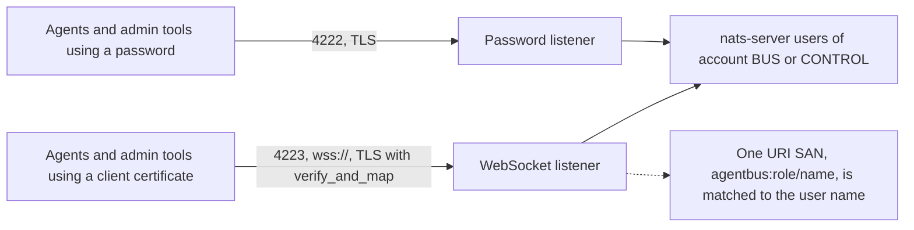
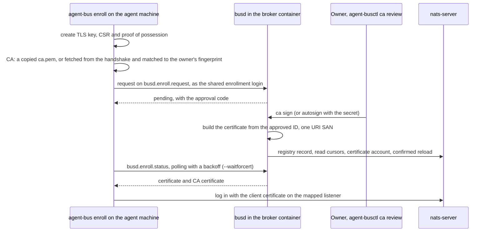

# Access control

[Design index](README.md) | previous: [safety](safety.md) | next: [private channels](private-channels.md)

Who may connect to the broker and what each account may do: accounts and TLS, the grants per
role, and how agents authenticate (passwords, client certificates in phase A, a Puppet-style
enrollment flow in phase B).

| Part | Status |
|---|---|
| TLS-only broker, private CA (`agent-busctl tls init`), static users with bcrypt passwords, per-role grants, `admin init`, generated `auth.conf` | implemented |
| Roles `agent`, `admin`, `enrollment`, `busd`, `monitor` | implemented; busd serves CONTROL as its own login (`busd`), the monitor has two read-only logins (`monitor-bus`, `monitor-control`), `agent-busctl service init` creates them on an older setup |
| mTLS phase A: certificate login on a second listener (`cert issue`, `cert sign`, `cert switch`) | implemented |
| mTLS phase B: enrollment flow, `ca list\|sign\|reject\|fingerprint\|review`, autosigning, CA key in a minimal busd (decision 41) | implemented (see below) |
| [Grants](#grants) | **split**: current grants are built; private-channel grants, the signed `busd.<method>` API, the `human_<owner>` and `monitor@<owner>` roles and the ledger are planned. busd's BUS connection is still `bus-admin` |

## Accounts and access

- Every client has its own broker account. An agent's account may:
  - read and acknowledge under its own name, and read its own DM channel;
  - write any DM channel, and read and write `general` and every group channel;
  - ask busd for the directory (`busd.directory.sync.<token>`) and for channel changes
    (`busd.channel.<token>`), and hear `directory.head`;
  - publish idempotently, so its own retries are not written twice within the broker's window.
- Planned: access to a private channel only when busd grants it
  ([private channels](private-channels.md)). Planned: reads of the registry and the catalogue
  through busd's signed API; today agents read the directory busd syncs to them
  ([directory v2](directory-v2.md)).
- Only the admin principal writes the registry and the public catalogue and creates channels. Agents hold no admin rights and cannot choose broker resource names. They cannot create or delete their own read cursors either: busd provisions them (on registration, `join` and invitation) and removes them when access ends ([JetStream binding](jetstream-binding.md), [busd](busd.md)).
- The monitor's account reads every channel through ordered consumers of its own (a known limit: they need `CONSUMER.CREATE`), and it never touches an agent's consumer. Planned: a durable consumer `bus-monitor` made by busd ([JetStream binding](jetstream-binding.md), [monitor](monitor-and-api.md)).
- **Decision: encrypted connection to the broker.** Every client (`agent-bus`, `agent-busctl`, `busd`, `bus-monitor`) connects over TLS; the broker has no plaintext listener. The broker is assumed to be on the local network. If a machine is elsewhere, the owner sets up a secure tunnel or VPN to reach it; the bus does not provide one. agent-busctl creates a private CA and the broker's certificate during setup (`agent-busctl tls init`). Clients trust that CA only, given by a `--ca-cert` flag (default `~/.config/agent-bus/ca.pem`). No public CA is needed on a LAN.

Note that broker access and message signatures do different jobs: access rules control who can reach what on the broker; signatures prove authorship end-to-end and survive replication, export, and a compromised broker.

## Encrypted connection

**TLS.** The server's `tls { cert_file, key_file }` block is the only listener (no plaintext port). The certificate comes from the private CA (`agent-busctl tls init`, [bus model](bus-model.md)); clients trust that CA as their root (`nats.Secure` with a `tls.Config{RootCAs}`). TLS protects the connection to the server; it does not authenticate busd ([busd](busd.md)).

The two client listeners:

## Grants

Every client is a static user with a password (stored bcrypt-hashed) or a client certificate, and
its own permissions. Credentials sit with the adapter's key, never in a project directory. NATS
authentication identifies the account; the Ed25519 signature
([signing and trust](identity-and-trust.md), [busd](busd.md)) is the identity.

A publisher can name any reply subject, so busd's responses go where the caller says. That is
harmless because they are signed or inbox tokens are random. A request can also arrive by
redirection; busd authorises from its signed content, not from the subject ([busd](busd.md)).

### Current grants (built)

Generated by `internal/broker/authconf.go`; the per-channel part is rewritten by reload.

| Role (account) | Operation | Subjects |
|---|---|---|
| Agent `<t>` (`BUS`) | send and publish | `dm.*`, `general`, `topic.*` |
| | receive, per own consumer `<c>` | `$JS.API.CONSUMER.MSG.NEXT.BUS.<c>`, `$JS.API.CONSUMER.INFO.BUS.<c>`, `$JS.ACK.BUS.<c>.>` |
| | replies | subscribe `_INBOX.<t>.>` |
| | presence | publish `presence.<t>`; direct get `$JS.API.DIRECT.GET.PRESENCE.presence.*` |
| | directory | publish `busd.directory.sync.<t>`; subscribe `directory.head` ([directory v2](directory-v2.md)) |
| | channels | publish `busd.channel.<t>` ([agent channels](agent-channels.md)) |
| | placeholders | publish `busd.nonce`, `busd.history`, `busd.registry.get`, `busd.registry.changes`, `busd.catalogue.list`, `busd.agent.rotate`: granted, nothing answers them yet |
| Monitor `monitor-bus` (`BUS`) | read-only | its own ordered consumers, consumer and stream info, presence; subscribe `directory.head`; no publish to any message subject |
| Monitor `monitor-control` (`CONTROL`) | read-only | requests to busd for `busd.monitor.registry` and `busd.monitor.catalogue`; its own reply inbox; the pending count; no `$JS.API` subject |
| busd (`BUS` connection, as `bus-admin`) | provisioning and directory | `$JS.API.>`; publish `directory.head`; subscribe `busd.directory.sync.*` and `busd.channel.*` |
| busd (`CONTROL`, login `busd`) | registry, catalogue, enrollment | JetStream read API of `KV_registry` and `KV_catalogue`; publish `$KV.registry.>`, `$KV.catalogue.>`, `_INBOX.>`, `busd.enroll.pending`; subscribe `_INBOX.>` and its seven `busd.enroll.*`, `busd.ca.*` and `busd.monitor.*` subjects |
| Enrollment login `enroll` (`CONTROL`, shared, password listener) | ask for a certificate | publish `busd.enroll.request` and `busd.enroll.status`; subscribe `_INBOX.enroll.>` ([phase B](#phase-b-implemented-the-enrollment-flow)) |
| `bus-admin` (`BUS`) and `control-admin` (`CONTROL`), used by `agent-busctl --direct` | everything in their own account | publish and subscribe `>`. NATS usernames are server-wide, so the two are distinct users with separate passwords, which live only in the owner's config ([admin CLI](admin-cli.md)) |

The agents' consumers are `<t>__dm`, `<t>__general` and `<t>__g__<name>` for every catalogued
group.

### Subject details (built)

- **Agent "never".** An agent holds no consumer create, delete or update grant; no
  `$JS.API.DIRECT.GET` except the one for stream `PRESENCE` subject `presence.*` (so `list_agents`
  can read others' presence; never a direct get on stream `BUS`); no wildcard consumer, `MSG.NEXT`
  or ack grant; no `$KV.*` or `ledger.*` subject.
- **Directory.** busd answers a request on `busd.directory.sync.<t>` only on a literal subject
  `_INBOX.<t>.<token>...`, the inbox of the agent the subject names, and limits each agent on its
  own. Channel requests are answered the same way.
- **Replies.** The client uses `nats.CustomInboxPrefix("_INBOX.<t>")`, so its replies fall inside
  its grant.
- **busd's acks.** None for ordered consumers; a durable consumer of its own would need
  `$JS.ACK.BUS.<name>.>`.
- **busd and the redirection.** busd's own raw reads are safe from reply-subject redirection,
  since it replies only into the caller's inbox prefix and serves no raw JetStream to anyone.

### Planned grants (not built)

| Role (account) | Operation | Subjects |
|---|---|---|
| Agent `<t>` (`BUS`) | private channels | send and publish `private.<id>` for each private channel it belongs to; consumers `<t>__p__<id>` |
| | call busd | the signed `busd.<method>` API, answered in `_INBOX.<t>.>` (today only the placeholders above are granted) |
| Owner `human_<owner>` (`BUS`, used by agent-busctl) | post, and the agent's busd calls | as an agent for DMs, `general` and groups; `private.<id>` where busd granted it; no consumers |
| | owner-only busd methods | publish `busd.nonce`, `busd.agent.register`, `busd.agent.revoke`, `busd.agent.rotate`, `busd.channel.manager`, `busd.channel.create_group` |
| Monitor `monitor_<owner>` (`BUS`; also used by `agent-busctl` read commands) | read, from the consumer busd made | `$JS.API.CONSUMER.MSG.NEXT.BUS.bus-monitor`, `$JS.API.CONSUMER.INFO.BUS.bus-monitor`, `$JS.ACK.BUS.bus-monitor.>`; subscribe `_INBOX.monitor.>` |
| | read-only busd methods | publish `busd.nonce`, `busd.history`, `busd.registry.get`, `busd.registry.changes`, `busd.catalogue.list`, `busd.channel.list`, `busd.channel.membership` |
| busd (`BUS`) | its API | subscribe `busd.>` and `_INBOX.busd.>`; publish `_INBOX.>` for replies |
| busd (`CONTROL`) | ledger | `ledger.>`, and `$JS.ACK.<stream>.<name>.>` for a durable consumer of its own |

### Subject details (planned)

- **Monitor identity.** The monitor gets its own narrow signing identity, `monitor@<owner>`, with
  its own Ed25519 key registered with the role `monitor`. busd lets it call only the read-only
  methods above; it never uses the owner's key. Today the monitor signs, when it sends, as an
  ordinary registered agent identity.
- **Monitor consumer.** busd, not the monitor, creates `bus-monitor`, so the monitor needs no
  create grant. Today the monitor reads with its two logins and ordered consumers of its own
  (see [Known limits](#known-limits)). It never touches an agent's consumer.
- **Membership.** `busd.channel.membership` returns all channels with signed watermarks;
  `busd.channel.list` returns the private catalogue of all channels to this identity.
- **Never, for the monitor.** Any consumer create, update or delete; any publish on a message
  subject, any stream, KV or `CONTROL` subject; any other busd method.
- **Residual limit.** Read-only still has a limit: any raw JetStream reader, the monitor included,
  can make the server deliver a payload it can read to any subject of `BUS` it can name. Grants
  within one account cannot close that. The receiver checks
  ([private channels](private-channels.md), [signing and trust](identity-and-trust.md)) are what
  make it harmless.

## Known limits

- *`monitor-bus` can create, update and delete `BUS` consumers.* JetStream grants cannot name
  consumer prefixes, and ordered history reads need create. A compromised monitor can disrupt
  delivery or reset cursors, but cannot read keys, impersonate agents (no signing keys) or approve
  anything. Planned fix: busd serves history and provisions the monitor's consumers. See
  [Safety](safety.md#known-limit-the-monitor-can-disturb-consumers).

## mTLS login and enrollment

### Phase A (implemented): certificate login without enrollment

**Phase A (built): certificate login without enrollment.** The owner issues the certificates at
the broker's host (`agent-busctl --direct cert issue|sign|switch`, docs/agent-busctl.md) and
copies them to the agent's machine; no request or approval flow. What differs from the plan below:

- *The second listener is nats-server's WebSocket listener.* nats-server has one client port and
  allows `verify_and_map` once per listener, which then demands a client certificate from every
  client of it. So the password listener (`BUS_NATS_PORT`, 4222) is unchanged, and certificate users
  log in on a `websocket` listener with its own TLS block and `verify_and_map` (`BUS_MAPPED_PORT`,
  4223; clients use a `wss://` address). Users of certificate mode carry
  `allowed_connection_types: ["WEBSOCKET"]`.
- *Mapping.* The certificate has exactly one URI SAN, `agentbus:<role>/<name>/<certID>`:
  `agentbus:agent/<agent token>/<certID>`, `agentbus:admin/bus-admin/<certID>`,
  `agentbus:admin/control-admin/<certID>`. nats-server matches email, DNS and URI SANs against user
  names before the subject DN, and the NATS user of a certificate login is named exactly that URI;
  the permissions are those of the role (agent grants use the token). Verified in nats-server
  v2.15.3 (`checkClientTLSCertSubject`, `canTLSMap`).
- *Revocation.* The certID is what makes a certificate revocable. A principal has one entry in
  the authorization file, which names the certID of its current certificate; issuing another,
  `cert sign`, an approval (also with `--replace`), `agent remove` and the switch back to the
  password rewrite or delete the entry, and every earlier certificate maps to no user, so its login
  is refused after the confirmed reload (its open connections close with it). Considered and
  rejected: an allowlist of client-certificate fingerprints. nats-server accepts `pinned_certs` in
  the `websocket` TLS block (a hash of the certificate's public key), but v2.15.3 applies it to
  an already connected client at a reload and never at the login of a new WebSocket one
  (`matchesPinnedCert` runs for the plain client listener's handshake and in `reload.go`, not in
  the WebSocket accept path); checked by logging in with an unpinned certificate, which was
  accepted. nats-server has no revocation list for client certificates either. A certificate
  made before certIDs (URI SAN without one) keeps working until it is issued again, which is how an
  existing setup migrates without a step.
- *Certificates* are built by `tlsinit.CA.IssueClientCert` from the approved identity only: client
  auth, not a CA, one year by default, no names from a CSR (`SignCSR` checks the request's signature
  and uses only its public key).
- *Roles and modes.* The authorization files model agent, admin, busd, monitor and enrollment users,
  in password or certificate mode, and are rewritten without losing any entry (the role is a trailing
  comment; older files are still read). The principals besides the agents are `bus-admin` and
  `control-admin` (`>`), `busd` (CONTROL: read the registry and the catalogue, write registry
  records and catalogue entries, `_INBOX.>`, the pending count; no stream delete or purge, no ledger write),
  `monitor-bus` (BUS: its own ordered consumers, consumer and stream info, presence; publishes no
  message) and `monitor-control` (CONTROL: ask busd for the registry and the catalogue, hear the
  pending count; no approval subject and no JetStream subject, because a direct-get grant lets its
  holder name a `$KV.registry.<token>` reply subject that writes: NATS only rejects `$JS.*` ones.
  busd's own raw reads are safe from that, since it replies only into the caller's inbox prefix
  and serves no raw JetStream to anyone). They log in with passwords. `agent-busctl admin init` creates all of
  them; on a setup older than this, `agent-busctl service init` adds the three. Until then busd
  and the monitor fall back to the admin logins and say so in their log.
- *busd answers into inbox space only.* The sender of a request names its reply subject, and busd
  publishes the reply itself. It therefore answers an enrollment request only below
  `_INBOX.enroll.` and an owner command below `_INBOX.agent-busctl.`, to a literal subject, and
  drops anything else (it logs the first). With its own narrow login a request could not reach more
  than busd may do anyway.
- *Rollback and removal.* `cert switch <id> --password` goes back; `agent remove` drops the
  mapping with the account and the tombstone keeps the ID from being certified again.
- *Reload topology.* Only the broker's container reloads nats-server; the monitor container never
  signals (docs/broker.md).

### Phase B (implemented): the enrollment flow

**Phase B (built, decision 41): the enrollment flow.** A new machine asks for a client certificate
and the owner approves it; the owner's tools are `agent-busctl ca review` (a terminal screen,
`podman exec -it agent-bus agent-busctl ca review`) and `agent-busctl ca list|sign|reject|fingerprint`.
User documentation: [docs/podman.md](../podman.md#9-enrolling-a-new-machine). **Decided (owner,
2026-11-25): busd holds the CA key, not the monitor.** A minimal busd ([busd](busd.md)) runs in the
broker's container, holds the CA key, signs certificates, keeps the pending requests and makes every
auth-file change and reload locally. It has no HTTP interface. The monitor stays strictly
read-only: it shows the number of pending requests and has no CA key and no approval endpoint.

What was built, and where it differs from the plan above it:

- **Where busd's API lives: the `CONTROL` account.** The subjects `busd.enroll.request`,
  `busd.enroll.status`, `busd.ca.list|sign|reject` and the announcement `busd.enroll.pending` are in
  `CONTROL`, which agents cannot reach: not by login, and not by the JetStream redirection that lets
  any `BUS` reader make the server publish a stored payload onto a subject of `BUS` it names. busd
  also drops every message without a reply subject, so a reply or a publication redirected onto
  one of its subjects is not taken for a request. The owner's tools log in as `control-admin`.
- **The enrollment login** is the shared user `enroll`, role `enrollment`, in `control-auth.conf`,
  on the password listener (no listener of its own). Grants: publish `busd.enroll.request` and
  `busd.enroll.status`, subscribe `_INBOX.enroll.>`; nothing else, so no stream, JetStream API or
  `BUS` access. Its password is made by `agent-busctl enroll init` (`enroll/password`, shown once).
  Each client uses a random inbox prefix under `_INBOX.enroll.`, but the login is shared, so
  **residual risk:** anyone who has it can read the replies meant for other enrollees. Replies
  therefore hold only public data (certificate, CA certificate); the client believes only an
  answer that names its own request ID and installs only a certificate for exactly its agent and
  TLS key, signed by the CA it trusts. The login proves no identity: it is a ticket to ask.
- **The directory.** The approval reply carries no directory: the reply is unsigned, and whoever
  has the shared login could overhear it and answer in its place with a forged one. The enrolled
  agent syncs the signed directory from busd with its own login instead, as every running agent
  does ([directory v2](directory-v2.md)), and keeps no copy of the enrollment password.
- **Request.** `agent-bus enroll --broker <host> --agent <id> [--waitforcert[=<max>]] [--secret <s>]
  [--ca-fingerprint <sha256>]`. An existing identity keeps its signing key (and so its pins, ID and
  consumers); only the TLS key and CSR are new. The request has the agent ID, CSR, public signing
  key, hostname and a fresh nonce, with an Ed25519 signature over all of them (proof of
  possession, domain-separated). The **approval code** is the first 40 bits of the SHA-256 of that
  whole request (`XXXX-XXXX`), the request ID is the full digest. The machine prints the code and
  the signing key fingerprint; the owner sees them with the TLS key fingerprint.
- **Trust in the broker.** `enroll` needs the CA certificate: a copied `ca.pem`, or `--ca-fingerprint`
  from `agent-busctl ca fingerprint`. With the fingerprint, the CA is read from the broker's TLS
  handshake (`tls init` now has the broker send the CA after its own certificate) *before* any
  password is sent, and kept only if its SHA-256 matches and it signs the broker's certificate. A CA
  learned from the enrollment endpoint alone is never trusted. A broker certificate made by an older
  `tls init` lacks the CA: copy `ca.pem` or append it once (optional migration, docs/podman.md).
- **Pending requests** (busd, in memory and `enroll/state.json`, which holds public data only):
  at most 8 KiB each, 100 pending, 3 per agent ID, 10 requests a minute (burst 10), expiry after 24
  hours (the agent then hears "expired"), a decided request is kept 24 hours for the agent to
  collect, a request of the same agent ID and signing key supersedes the earlier one. Over a limit
  the answer is `busy` and the agent retries. **The rate limit and the cap of 100 pending requests
  are global, not per sender**: the login is shared, so one machine (or anyone with the enrollment
  password) that asks in a loop can use them up and make others hear `busy` until it stops. That
  is accepted on a trusted LAN; the owner's recourse is `enroll init --force` (a new password).
- **Text from the network is cleaned before it is shown.** A request's fields, the reasons and
  messages busd sends and the registry's errors can come from a machine that is not trusted yet.
  `ca list`, `ca review` and `agent-bus enroll` strip control characters (escape sequences, line
  breaks, bidirectional overrides) from them before printing; busd also accepts only printable
  text in a request.
- **Approval** is single-use: only a pending request can be approved. busd builds the certificate with
  `SignCSR` from the approved agent ID and the CSR's public key alone, the CSR's own names and
  usages are ignored (phase A code). A removed (tombstoned) ID is refused at request and at approval.
  An ID that is registered *with the same signing key* only switches to certificate login. An ID
  registered *with another key* is flagged `replaces` and needs an explicit confirmation (`ca sign
  --replace`, a yes in the screen); then its current key is revoked and the new one added. Steps: the
  registry record, the read cursors of DM and `general`, the account in certificate mode (one confirmed
  reload), busd's own machine's lookup file `<config>/directory` updated last; each repeatable, so a failed approval stays pending. An
  approval holds the config directory's `nats/mutations.lock` (flock) from the check of the registry
  to the last step, and so does every `agent-busctl --direct` command for its whole run, so a
  removal and an approval, which are separate processes, never interleave: an approval that
  waited for a removal sees the tombstone and refuses, instead of recreating the account. A
  waiter gives up after its timeout (`--timeout`, one minute for busd) with "another process holds
  ...". The authorization-file lock of each reload is taken inside it.
- **Autosign** (off by default): `agent-busctl enroll autosign` writes `enroll/autosign`, which busd reads on
  every request; a request with the matching secret (constant-time compare) is approved at once, never
  for an ID that would be replaced, and logged. An empty or missing file means off.
- **Monitor.** busd announces the pending count every five seconds on `busd.enroll.pending`; the
  monitor shows it in its header and hides it when it stops coming.
- **Certificates** are as in phase A: client use only, not a CA, one URI SAN, one year (`BUS_CERT_VALIDITY`
  of busd). Renewal is still `cert issue`, or enrolling again from the machine; either replaces the earlier
  certificate of the ID (revocation, above).
- **Removal** is as before (`agent remove`: mapping dropped with the account, ID tombstoned, never
  reused). Other agents learn of the removal through the directory sync ([directory v2](directory-v2.md); an older agent still
  needs `directory export`); an enrolled machine starts with the directory busd returns.

Not built from the earlier plan: busd's signed `busd.<method>` API for agents (only the enrollment
and approval subjects exist), reload through a helper called by the monitor (busd reloads locally, the
monitor never signals), a certificate renewal command, and a separate enrollment listener (the shared
login uses the password listener). Admin certificates are still `cert issue --admin`; busd must be
restarted after it (`pkill busd`, the entrypoint starts it again) to read them.

## See also

- [JetStream binding](jetstream-binding.md): what the subjects and consumers mean.
- [Operations](operations.md): reload, ports and the two-container topology.
- [docs/agent-busctl.md](../agent-busctl.md#cert-issue): the `cert` commands.
