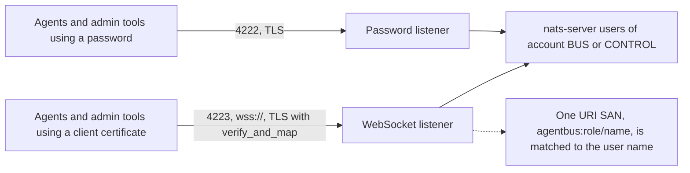
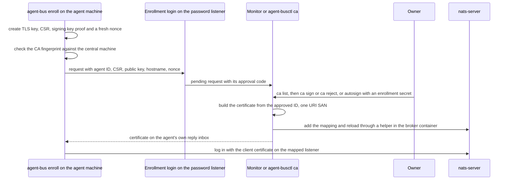

# Access control

[Design index](README.md) | previous: [safety](safety.md) | next: [private channels](private-channels.md)

Who may connect to the broker and what each account may do: accounts and TLS, the grants matrix per
role, and how agents authenticate (passwords today, client certificates in phase A, a Puppet-style
enrollment flow in phase B).

| Part | Status |
|---|---|
| TLS-only broker, private CA (`agent-busctl tls init`), static users with bcrypt passwords, per-role grants, `admin init`, generated `auth.conf` | implemented |
| Roles `agent`, `admin` | implemented; `monitor` and `enrollment` roles are reserved with no access (the monitor logs in as the two admin users) |
| mTLS phase A: certificate login on a second listener (`cert issue`, `cert sign`, `cert switch`) | implemented |
| mTLS phase B: enrollment flow, `ca list\|sign\|reject`, autosigning, CA key location | **planned**, and **under review** (see below) |
| The busd and monitor columns of the grants matrix | **planned** (no busd, no `monitor_<owner>` user yet) |

## Accounts and access

- Every client has its own broker account. An agent's account may: read and acknowledge under its own name, read its own DM channel, write any DM channel, read and write `general` and every group channel, read the registry and the public catalogue (through busd), and publish idempotently, so its own retries are not written twice within the broker's window. It gets access to a private channel only when busd grants it ([private channels](private-channels.md)).
- Only the admin principal writes the registry and the public catalogue and creates channels. Agents hold no admin rights and cannot choose broker resource names. They cannot create or delete their own read cursors either: busd provisions them (on registration, `join` and invitation) and removes them when access ends ([JetStream binding](jetstream-binding.md), [busd](busd.md)).
- The monitor's account may pull from its own durable consumer `bus-monitor` over every channel; busd creates that consumer, the monitor creates none and never touches an agent's consumer ([JetStream binding](jetstream-binding.md), [monitor](monitor-and-api.md)).
- **Decision: encrypted connection to the broker.** Every client (`agent-bus`, `agent-busctl`, `busd`, `bus-monitor`) connects over TLS; the broker has no plaintext listener. The broker is assumed to be on the local network. If a machine is elsewhere, the owner sets up a secure tunnel or VPN to reach it; the bus does not provide one. agent-busctl creates a private CA and the broker's certificate during setup (`agent-busctl tls init`). Clients trust that CA only, given by a `--ca-cert` flag (default `~/.config/agent-bus/ca.pem`). No public CA is needed on a LAN.

Note that broker access and message signatures do different jobs: access rules control who can reach what on the broker; signatures prove authorship end-to-end and survive replication, export, and a compromised broker.

## Encrypted connection

**TLS.** The server's `tls { cert_file, key_file }` block is the only listener (no plaintext port). The certificate comes from the private CA (`agent-busctl tls init`, [bus model](bus-model.md)); clients trust that CA as their root (`nats.Secure` with a `tls.Config{RootCAs}`). TLS protects the connection to the server; it does not authenticate busd ([busd](busd.md)).

The two client listeners:

## Grants matrix

**Accounts and permissions.** Every client is a static user with a password (stored bcrypt-hashed) and its own permissions. Credentials sit with the adapter's key, never in a project directory. NATS authentication identifies the account; the Ed25519 signature ([signing and trust](identity-and-trust.md), [busd](busd.md)) is the identity. A publisher can name any reply subject, so busd's responses go where the caller says; that is harmless because they are signed and inbox tokens are random. A request can also arrive by redirection; busd authorises from its signed content, not from the subject ([busd](busd.md)).

| Role (account) | Operation | Subjects |
|---|---|---|
| Agent `<t>` (`BUS`) | send and publish | `dm.*`, `general`, `topic.*`, and `private.<id>` for each private channel it belongs to |
| | receive, per own consumer `<c>` | `$JS.API.CONSUMER.MSG.NEXT.BUS.<c>`, `$JS.API.CONSUMER.INFO.BUS.<c>` (to notice a lost consumer), `$JS.ACK.BUS.<c>.>`; the consumers are `<t>__dm`, `<t>__general`, `<t>__g__<name>` for every catalogued group and `<t>__p__<id>` for each private channel it belongs to |
| | replies | subscribe `_INBOX.<t>.>` (the client uses `nats.CustomInboxPrefix("_INBOX.<t>")`) |
| | presence | publish `presence.<t>` (own record only); direct get `$JS.API.DIRECT.GET.PRESENCE.presence.*` (stream `PRESENCE` only) |
| | call busd | publish `busd.nonce`, `busd.channel.create`, `busd.channel.list`, `busd.channel.members`, `busd.channel.membership`, `busd.channel.invite`, `busd.channel.remove`, `busd.channel.leave`, `busd.channel.join`, `busd.history`, `busd.registry.get`, `busd.registry.changes`, `busd.catalogue.list`, `busd.agent.rotate` |
| | never | consumer create, delete or update; any `$JS.API.DIRECT.GET` except the one for stream `PRESENCE`, subject `presence.*` (granted as `$JS.API.DIRECT.GET.PRESENCE.presence.*`, so `list_agents` can read others' presence; never a direct get on stream `BUS`); any wildcard consumer, `MSG.NEXT` or ack grant; any `$KV.*` or `ledger.*` subject; the owner-only busd methods |
| Owner `human_<owner>` (`BUS`, used by agent-busctl) | post, and the agent's busd calls | as an agent for DMs, `general` and groups; `private.<id>` where busd granted it ([private channels](private-channels.md)); no consumers |
| | owner-only busd methods | publish `busd.nonce`, `busd.agent.register`, `busd.agent.revoke`, `busd.agent.rotate`, `busd.channel.manager`, `busd.channel.create_group` |
| Monitor `monitor_<owner>` (`BUS`; also used by `agent-busctl` read commands) | read, from the consumer busd made | `$JS.API.CONSUMER.MSG.NEXT.BUS.bus-monitor`, `$JS.API.CONSUMER.INFO.BUS.bus-monitor`, `$JS.ACK.BUS.bus-monitor.>`, subscribe `_INBOX.monitor.>` |
| | read-only busd methods | publish `busd.nonce`, `busd.history`, `busd.registry.get`, `busd.registry.changes`, `busd.catalogue.list`, `busd.channel.list`, `busd.channel.membership` (`busd.channel.membership` for all channels, with signed watermarks; `busd.channel.list` returns the private catalogue of all channels to this identity) |
| | never | any consumer create, update or delete; any publish on a message subject, any stream, KV or `CONTROL` subject; any other busd method |
| busd, message connection (`BUS`) | consumers (agents' and the monitor's), history, stream info | `$JS.API.>` |
| | its API | subscribe `busd.>`, subscribe `_INBOX.busd.>`, publish `_INBOX.>` (replies) |
| | acks | none for ordered consumers; a durable consumer of its own needs `$JS.ACK.BUS.<name>.>` |
| busd, control connection (`CONTROL`) | registry, catalogue, ledger | `$JS.API.>`, `$KV.>`, `ledger.>`, subscribe `_INBOX.busd.>`, and `$JS.ACK.<stream>.<name>.>` for a durable consumer of its own |
| `bus-admin` (`BUS`) and `control-admin` (`CONTROL`), used by `agent-busctl --direct` over two connections | everything in its own account | publish and subscribe `>`; NATS usernames are server-wide, so the two are distinct users with separate passwords, which live only in the owner's config ([admin CLI](admin-cli.md)) |

The monitor has its own narrow signing identity, `monitor@<owner>`, with its own Ed25519 key registered with the role `monitor`: busd lets it call only the read-only methods above. It never uses the owner's key. busd, not the monitor, creates the monitor's consumer, so the monitor needs no create grant. Read-only still has a limit: any raw JetStream reader, the monitor included, can make the server deliver a payload it can read to any subject of `BUS` it can name. That cannot be closed by grants within one account. The receiver checks ([private channels](private-channels.md), [signing and trust](identity-and-trust.md)) are what make it harmless. The grants for the busd methods and the consumers are generated; the per-channel part is rewritten by reload (below).

## mTLS login and enrollment

### Phase A (implemented): certificate login without enrollment

**Phase A (built): certificate login without enrollment.** The owner issues the certificates at
the broker's host (`agent-busctl --direct cert issue|sign|switch`, docs/agent-busctl.md) and
copies them to the agent's machine; no request or approval flow. What differs from the plan below:

- *The second listener is nats-server's WebSocket listener.* nats-server has one client port and
  allows `verify_and_map` once per listener, which then demands a client certificate from every
  client of it. So the password listener (`BUS_NATS_PORT`, 4222) is unchanged, and certificate users
  log in on a `websocket` listener with its own TLS block and `verify_and_map` (`BUS_MAPPED_PORT`,
  4223; clients use a `wss://` address). Users of certificate mode carry
  `allowed_connection_types: ["WEBSOCKET"]`.
- *Mapping.* The certificate has exactly one URI SAN, `agentbus:<role>/<name>`: `agentbus:agent/<agent
  token>`, `agentbus:admin/bus-admin`, `agentbus:admin/control-admin`. nats-server matches
  email, DNS and URI SANs against user names before the subject DN, and the NATS user of a
  certificate login is named exactly that URI; the permissions are those of the role (agent grants
  use the token). Verified in nats-server v2.15.3 (`checkClientTLSCertSubject`, `canTLSMap`).
- *Certificates* are built by `tlsinit.CA.IssueClientCert` from the approved identity only: client
  auth, not a CA, one year by default, no names from a CSR (`SignCSR` checks the request's signature
  and uses only its public key).
- *Roles and modes.* The authorization files model agent, admin, monitor and enrollment users, each
  in password or certificate mode, and are rewritten without losing any entry (the role is a trailing
  comment; older files are still read). Monitor and enrollment are reserved with no access. The web
  monitor has no user of its own yet: it logs in as the two admin users, so `cert issue --admin`
  covers it.
- *Rollback and removal.* `cert switch <id> --password` goes back; `agent remove` drops the
  mapping with the account and the tombstone keeps the ID from being certified again.
- *Reload topology.* Only the broker's container reloads nats-server; the monitor container never
  signals (docs/broker.md).

### Phase B (planned): the enrollment flow

**Phase B (planned): the enrollment flow.** Everything below that phase A did not build:
the request/approval flow, `ca list|sign|reject`, the monitor's pending list and CA key, the
enrollment login and its limits, autosigning, `--waitforcert`, the CA fingerprint check, and the
monitor reloading nats-server through a helper in the broker container. The enrollment login needs
no listener of its own: it stays a password user of the password listener.

**Decision** (owner, 2026-11-24, after a design review): agents get client certificates from the bus CA through a Puppet-style enrollment flow, replacing agent passwords. Planned after agent removal, the protocol fixes and the minimal monitor API.

> **Decided (owner, 2026-11-25, decision 41): busd holds the CA key, not the monitor.** A minimal
> busd in the broker container holds the CA key, signs certificates, keeps the pending enrollment
> requests and makes every auth-file change and reload. The monitor stays strictly read-only: it
> shows the number of pending requests, nothing more. Approval is a TUI, `agent-busctl ca review`
> (run with `podman exec -it agent-bus …`), plus `agent-busctl ca list|sign|reject` for scripts;
> no web approval page. Where the text below says the monitor signs or reloads, read busd.

- **Request.** `agent-bus enroll --broker <host> --agent <id>` creates the TLS key and CSR on the agent's machine (an existing agent keeps its signing key, ID, consumers and local state; a new one also creates its Ed25519 key). Keys never leave the machine. The request carries the agent ID, CSR, public signing key with proof of possession, hostname and a fresh nonce; its approval code is derived from all of these, so it cannot be reused for another request. `--waitforcert` keeps retrying until the request is approved or rejected.
- **Trust in the broker.** The CA fingerprint is confirmed against the value the central machine shows (or the CA certificate is copied once), never taken from the enrollment endpoint alone.
- **Enrollment login.** A shared enrollment login on a separate listener may only send a request and receive its own reply (dedicated inbox namespace), with size, pending-count, expiry and rate limits and no BUS, JetStream or admin access. It requests approval; it never proves identity. Optional autosigning: a request carrying a configured enrollment secret (like Puppet's challenge password) is approved automatically; off by default.
- **Approval.** The monitor's "pending agents" list (ID, hostname, fingerprints, code) or `agent-busctl ca list` / `agent-busctl ca sign <id>` / `agent-busctl ca reject <id>`. The monitor holds the CA key (mode 0600, never served, logged or exported); it is local-only and exposed only through a reverse proxy. Approvals are single-use and expire, and never overwrite an existing identity silently.
- **Certificates.** Built by us from the approved ID, never copied from the CSR: client-auth only, not a CA, bounded validity, one URI SAN that nats-server's `verify_and_map` maps to the agent's user. A renew/reissue command exists before certificates expire.
- **Broker.** The mapped mTLS listener and the password/enrollment listener are separate; admin users and the monitor get certificates before agents are switched; password logins are retired only after certificate login is verified (documented rollback). The generated authorization files model explicit roles (agent, admin, monitor, enrollment) and authentication modes, round-tripped without loss.
- **Removal.** Removing an agent drops its mapping and reloads; a removed ID is never reused while certificates issued for it are valid (tombstones in the registry). Agents learn about new and removed agents through a directory refresh and keep revoked fingerprints locally, checked even for pinned keys. **Implemented for password accounts** (`agent-busctl agent remove`, `agent-busctl directory export`, the adapter's local refresh; docs/agent-busctl.md): the directory is copied by hand until busd serves it over the bus.
- **Docker.** One supported topology lets the monitor reload nats-server (for example sharing the broker container's PID namespace); config is mounted as a directory so atomic replacement stays visible.

## See also

- [JetStream binding](jetstream-binding.md): what the subjects and consumers mean.
- [Operations](operations.md): reload, ports and the two-container topology.
- [docs/agent-busctl.md](../agent-busctl.md#cert-issue): the `cert` commands.
