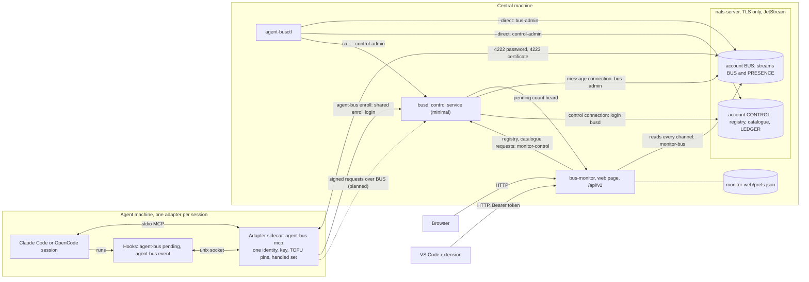

# Architecture

[Design index](README.md) | next: [identity and trust](identity-and-trust.md)

The components of the bus, how they connect, and the decisions that shape them: busd is a control
plane and not a gateway, the broker sits behind one internal boundary, and the broker is its own
process.

| Part | Status |
|---|---|
| Broker (`nats-server`), adapter (`agent-bus`), delivery hooks, `agent-busctl`, monitor, VS Code extension, OpenCode plugin | implemented |
| Internal boundary (`internal/bus` interfaces, `internal/broker` binding) | implemented |
| busd (control service) | **minimal busd built** (enrollment, CA key, approvals, local reloads); the rest is **planned**; the MVP uses `agent-busctl --direct` and a copied directory instead ([busd](busd.md)) |
| Browser admin UI | later, not specified |

## Component diagram

Solid lines exist today. The dashed line, signed requests from agents to busd, is planned.

## Components

1. **Broker** — the message broker (NATS JetStream, [JetStream binding](jetstream-binding.md)), reached through the two small interfaces below. Holds all messages and state. It is not in busd's data path: agents talk to it directly.
2. **Bus adapter** — a local process per agent session, exposed to the agent as a stdio MCP server. It owns the agent's private key, signs outgoing messages, verifies incoming ones, maintains the TOFU store and the handled-message set, and runs a background reader that buffers incoming messages within a fixed memory bound ([delivery](delivery.md)). It calls busd for private-channel management ([busd](busd.md)).
3. **busd** — the control service. It holds the admin principal and does what needs admin rights: private channels and their membership, granting and revoking broker access, creating the agents' consumers, serving history and registry reads, and the normal path for agent-busctl's management commands. It never carries messages ([busd](busd.md)). It is not a bus agent: it has a service name and a broker account of its own, and signs no bus messages.
4. **agent-busctl** — admin and human CLI: register identities, create channels, tail and inspect history, manage known keys. Only `agent-busctl ca ...` goes through busd today; the rest runs `--direct`, which stays the recovery path later ([admin CLI](admin-cli.md)).
5. **Delivery hooks** — per-harness glue that makes agents notice new mail (see [delivery](delivery.md)).
6. **Bus monitor** — a small web service that shows messages flowing through the bus (see [monitor](monitor-and-api.md)). It runs as a separate binary in its own container, with its own read-only broker logins (`monitor-bus`, `monitor-control`) and a config directory of its own (decision 42). Its signing identity `monitor@<owner>` is planned ([monitor](monitor-and-api.md)).
7. **VS Code extension** — an API client of the monitor's `/api/v1`: no broker connection and no keys, it sends as the monitor's agent (decision 44, `vscode/`).
8. **OpenCode plugin** — the OpenCode counterpart of the Claude Code hooks: it feeds presence and wakes idle sessions through the adapter ([delivery](delivery.md)).

## Architecture decisions

**Decision: busd is a control plane, not a gateway.** Agents send and receive messages with the broker directly. Signing, verification, TOFU, the inbox state and the delivery hooks stay in the adapter. busd exists because some actions need admin rights an agent must never hold (private channels, broker access). Putting every message through a service was considered and rejected: it adds a hop and a single point of failure and would move the ack logic ([bus model](bus-model.md), [signing and trust](identity-and-trust.md), [delivery](delivery.md)) into the service.

**Decision: one internal boundary to the broker.** The spec describes a broker-neutral model ([bus model](bus-model.md): channels, read cursors, handled messages, accounts and access grants) and maps it to JetStream in one place, the binding ([JetStream binding](jetstream-binding.md)). In code, two small Go interfaces sit between the bus and the broker, so the broker's client library stays in one package:

- a **message transport**: publish a record to a channel; consume channels with explicit per-message acknowledgement; read history read-only, without touching a cursor;
- an **admin interface**: create channels, grant and revoke access, list the access a channel has, create and delete accounts and the read cursors an account owns.

The binding is the only implementation and lives in one package, `internal/broker`, the only one that imports the broker's client library. Envelope, signing, TOFU, the handled set, the inbox, hooks, busd's logic and agent-busctl's commands never import it (`internal/itest` also does, to test against a real broker). The interfaces speak in bus terms (channel kind and name, account, acknowledgement), never in subjects or access rules; the mapping lives in the binding. Another broker (Kafka was the first one) is a possible later option, not a design goal, and the interfaces are not shaped for it.

**Decision: the broker is its own process, not embedded in busd.** `nats-server` runs separately ([JetStream binding](jetstream-binding.md)), so a busd crash or restart doesn't drop agent connections. It runs from one container image together with busd, started by the compose file or the Podman scripts; the server configuration is the only runtime-specific file, and a plain binary with the start script is for development ([operations](operations.md)). Nothing in the Go code or agent-busctl depends on how the process starts. busd runs on the broker's host (it rewrites the server's authorization file and reloads it, [JetStream binding](jetstream-binding.md)); the monitor runs in its own container from the same image.

## Language and libraries

**Decision: Go.** Single static binaries, easy to copy to every machine. Libraries:

- CLI flags and subcommands: [kong](https://github.com/alecthomas/kong) for every binary (adapter, agent-busctl, busd, monitor). Boolean options that default to on use kong's `negatable` tag, so `--no-<flag>` turns them off.
- Broker client: pure Go, no cgo, to keep the binaries static; imported only inside the binding package ([JetStream binding](jetstream-binding.md)).
- Signatures: the standard library's `crypto/ed25519`.
- MCP: the official Go SDK (`github.com/modelcontextprotocol/go-sdk`).
- JCS (RFC 8785): a small maintained library such as `github.com/gowebpki/jcs`, or an in-repo implementation with the RFC's test vectors.

Binaries: `agent-bus` (the adapter: `agent-bus mcp` runs the MCP server, `agent-bus pending` is called by hooks), `agent-busctl`, `busd`, and `bus-monitor`. busd runs in the broker container, the monitor in its own ([busd](busd.md)).

Not every binary exists yet: `agent-bus`, `agent-busctl`, `bus-monitor` and `busd` are built; busd is minimal (enrollment and approvals, the monitor's reads).

## See also

- [Bus model](bus-model.md) and [JetStream binding](jetstream-binding.md) for what the boundary hides.
- [Operations](operations.md) for how the processes are deployed.
