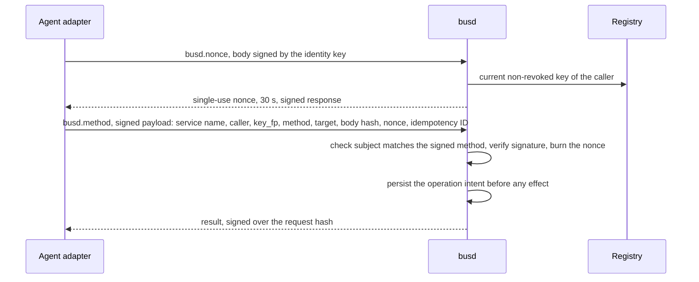

# busd, the control service

[Design index](README.md) | previous: [private channels](private-channels.md) | next: [admin CLI](admin-cli.md)

busd does the work that needs admin rights and never carries messages.

**Decision 41 (owner, 2026-11-25):** the first busd is minimal and comes before the enrollment flow.
It runs in the broker container, holds the CA key, signs certificates, keeps the pending
enrollment requests (received through the enrollment login) and makes every auth-file change and
reload, so nothing reloads nats-server across containers. It has no HTTP interface. The owner
approves requests in a TUI, `agent-busctl ca review`, or with `agent-busctl ca list|sign|reject`;
the monitor only shows how many are pending.

> **Status: a minimal busd is built (decision 41); the rest is planned (milestone 3).** What exists
> is `cmd/busd`, started by the broker container's entrypoint: it holds the CA key (`ca.key`, read
> from the config directory, never logged, served or exported), logs in as the two admin users
> (certificates if present, else passwords), keeps the pending enrollment requests, approves and
> rejects them, and makes the auth-file changes and confirmed reloads locally. Its API is request/reply on
> `busd.enroll.*` and `busd.ca.*` subjects of the `CONTROL` account (the signed `busd.<method>`
> protocol below is not built); it publishes the pending count for the monitor; it has no HTTP
> interface. As built: [access control](access-control.md#phase-b-implemented-the-enrollment-flow),
> user documentation [docs/podman.md](../podman.md#9-enrolling-a-new-machine). Still true of the MVP: `agent-busctl --direct` holds the
> admin credentials and does what busd would do: it creates identities, channels and the agents'
> consumers, and writes a **directory copy** (`directory/<agent-token>.json` and a `channels`
> snapshot) that is copied by hand to the agent machines instead of being served over the bus.
> Everything below that this note does not name describes the planned service.

## Request authentication

Every busd call is a request on a `busd.<method>` subject, signed by the caller's identity key:

## What it does

**What it does**

- Private channels and their membership: create, invite, remove, leave, list, and the private catalogue ([private channels](private-channels.md)).
- Broker access: it grants and revokes the broker access that membership implies, creates accounts and access for registered agents, and creates and deletes their consumers ([JetStream binding](jetstream-binding.md)). It holds the admin principal; admin credentials never leave it and the owner's config.
- Reads agents cannot do themselves: history, the registry and its changes and the catalogue, as signed replies ([JetStream binding](jetstream-binding.md)). The registry and the catalogue live in a NATS account agents cannot reach.
- The normal path for agent-busctl's management commands ([admin CLI](admin-cli.md)).
- Creating the monitor's consumer. The monitor ([monitor](monitor-and-api.md)) may share busd's binary but runs as a separate process with its own read-only principal and signing identity.
- A browser admin UI for the owner is later work and not specified here.

## State

**State.** The membership ledger ([private channels](private-channels.md)), the join boundaries, the reload generations and the operation intents: a plain stream in the broker's `CONTROL` account that only busd can write ([JetStream binding](jetstream-binding.md)). Everything else lives in the broker or in the adapters. busd reads the registry continuously (its own reader) to know every agent's current key and whether it is revoked. busd answers requests only after it has caught up with the registry (on start and after a reconnect), and checks the caller's authorisation again at the moment of each change.

## Authentication of agents

**Authentication of agents.** No new long-lived agent credential.

- busd's API is core request/reply on `busd.<method>` subjects of the bus connection ([JetStream binding](jetstream-binding.md)). busd's identity is a configured service name (for example `busd@<owner>`) and its own Ed25519 *service key*, created by `agent-busctl tls init` and pinned at setup: agent-busctl writes the public key into each identity's config next to the CA. The adapter takes `--busd-name`. TLS only protects the connection to the broker; it does not say who answers a `busd.*` subject, and a publisher can name any reply subject. So busd signs every response, nonce responses included, over a domain-separated payload (`agent-bus/busd-response/v1`) that binds the service name, the caller, the hash of the request or challenge and the result; the adapter refuses an unsigned or wrongly signed response.
- Calls that only read (history, registry, catalogue) carry a random challenge instead of a nonce. They are signed like any request, and the response signs the challenge.
- Nonce issuance does not depend on the subject it arrived on. The agent sends `busd.nonce` with a body signed by its identity key (agent ID, `key_fp`, random value, domain-separated). busd checks the signature first, then issues a nonce: random, single-use, valid for 30 seconds, at most ten outstanding per verified caller. Unverified nonce requests are dropped under a global rate limit and count against nobody, so a redirected or forged nonce request cannot use up another caller's ten. busd consumes a nonce atomically when a request uses it and forgets every outstanding nonce on restart; a retry takes a fresh nonce.
- The agent signs each request with its Ed25519 identity key. The signed payload is domain-separated with a fixed prefix (`agent-bus/busd-request/v1`) and binds: busd's service name, the caller's agent ID and `key_fp`, the method, the target (channel ID and member, where they apply), the SHA-256 of the body, the nonce and the idempotency ID. busd also checks that the subject the request arrived on is `busd.<method>` of the signed method, and refuses a mismatch.
- busd verifies the signature against the caller's current, non-revoked key in the registry. It never uses a key sent by the caller and never pins on first use. It burns the nonce, rejects a reused or expired one, and rejects any signature that does not cover the request it received.
- Authorisation comes from the verified signed content (caller, method, target): manager, member or owner, never from the subject a request arrived on, who published it, or an `agent_id` parameter. A request redirected to busd through a pull reply subject either fails these checks or is a validly signed request whose effect is exactly the signed one; a subject proves nothing about the requester.
- Every mutating request carries an idempotency ID so a client can retry safely. Before any effect, busd persists an operation intent keyed by `(caller, idempotency ID)` ([JetStream binding](jetstream-binding.md)): the hash of the semantic request (method, target and parameters, not the nonce or the signature, so a legitimate retry hashes the same) and every resource ID busd assigns, such as a new channel's ID. The effects follow. After a crash busd finishes that same operation from its intent and never allocates a second resource. The result is derived from the operation's confirmation events in the ledger; a retry with the same hash gets it, and waits if the operation is still finishing. The same ID with a different hash is refused ([private channels](private-channels.md)).
- The owner's calls (agent-busctl) are signed the same way by `human@<owner>`, whose key is unlocked by the master password ([monitor](monitor-and-api.md)).

## API

**API.** Agent-callable: create a private channel, list the caller's channels and members, invite, remove, leave, join and leave a group channel, history, registry reads, the public and the private catalogue, and rotating its own key (`busd.agent.rotate`, signed by the current key). The monitor identity may call only the read methods (history, registry, catalogue, and the all-channel `busd.channel.list` and `busd.channel.membership`). Everything else (register, revoke, rotation after a revocation, channels, incident revocation, other agents' channels) needs the owner. The API is in bus terms (channels, members, accounts); each method is one `busd.<method>` subject.

## If busd is down

**If busd is down.** busd runs supervised and restarts automatically; there is no HA. Agents and the monitor talk to the broker directly, and the access granted before stays in force.

| While busd is down | What happens |
|---|---|
| Send and receive on existing consumers, from senders whose keys are pinned, and private-channel mail inside the cached membership and watermark | works |
| Publishing a message | works; the message is stored. A `status` also needs its validation prerequisites (thread history, [protocol](protocol.md)) available locally, otherwise it is refused |
| A message from an unpinned sender (registry lookup), a private-channel message above the cached watermark, a cold start without pins or membership cache | held until busd answers; nothing is rejected for lack of an answer |
| Releasing held mail after `agent-busctl pin` | works (local), but it releases only the trust hold; membership holds and transition holds stay until their checks can run |
| Create, join, leave, invite, remove, register, revoke, rotate, agent-busctl management commands | fail with "busd is not reachable" and change nothing |
| `history`, `requests`, `agent-busctl tail` and `thread`, key lookups for unknown senders, membership refresh, news of a revocation, recreating a lost consumer | fail or wait until busd is back |
| The monitor's live view | works; history and keys it has not cached wait |

Recovery is `agent-busctl --direct` ([admin CLI](admin-cli.md)) or letting the supervisor restart busd, which finishes pending operations from their intents and reconciles on start.

## See also

- [Private channels](private-channels.md): the ledger and membership rules busd enforces.
- [JetStream binding](jetstream-binding.md): the `CONTROL` account where its state lives.
- [Architecture](architecture.md): why busd is a control plane and not a gateway.
