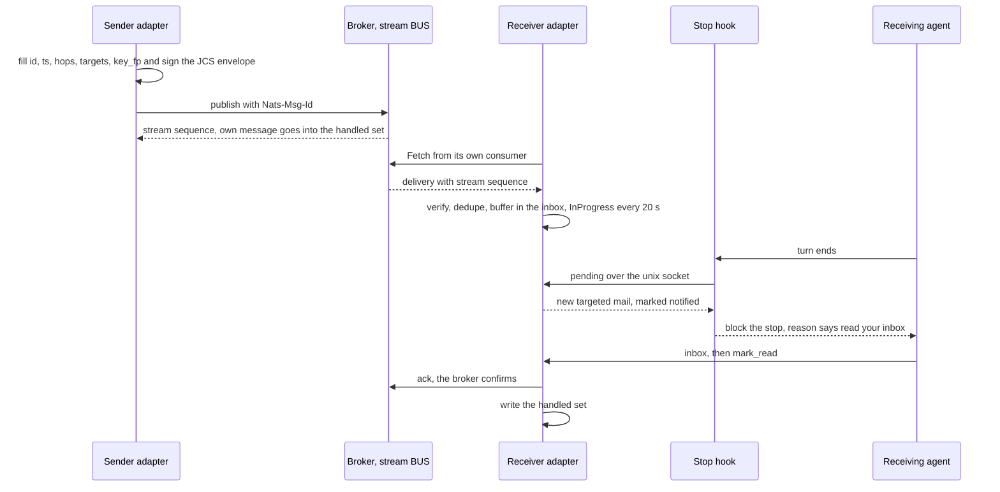
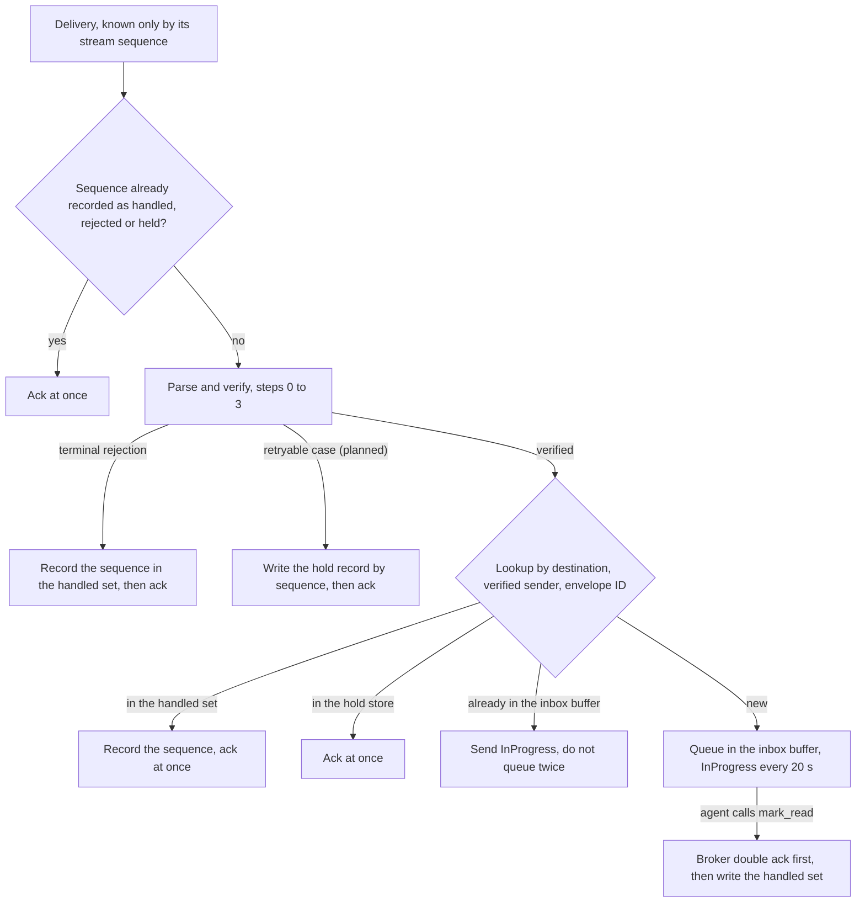
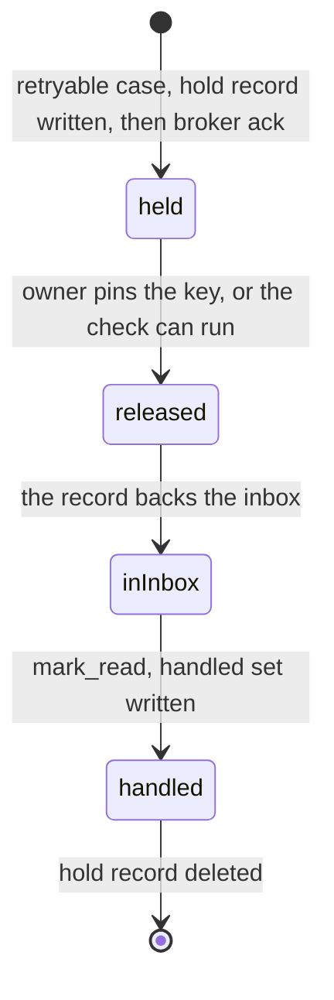

# Delivery

[Design index](README.md) | previous: [protocol](protocol.md) | next: [presence](presence.md)

How mail gets from the broker to an agent that cannot be interrupted: consumers and per-message
acks, the per-delivery state machine, holds, the inbox buffer, and the hooks that make an agent
notice mail or wake an idle session. Delivery is at-least-once.

| Part | Status |
|---|---|
| Per-agent durable pull consumers, per-message acks, handled set, `InProgress` keep-alive, bounded inbox buffer, `--deliver=targeted\|all`, notified-message tracking, notify cooldown | implemented |
| Claude Code hooks (`Stop`, `SessionStart`, the `asyncRewake` waiter), OpenCode plugin, `wait_for_messages` | implemented (the OpenCode plugin is tried against OpenCode 2.3.0, [docs/opencode.md](../opencode.md)) |
| Holds (hold store on disk, held / released / handled states) | **planned**; today a changed key is terminally rejected and alerted, and a sender whose registry record cannot be read is left unacked so the broker redelivers it |
| Consumer provisioning by busd, recreation from the join boundary | **planned** (today `agent-busctl --direct` creates consumers) |

## The path of one message

## Consumers and acks

**Delivery: consumers and acks.** busd provisions every consumer; an agent only pulls from its own.

- busd creates an agent's durable pull consumers: on register (DM `<t>__dm` filtered on `dm.<t>`, and `<t>__general` filtered on `general`), on a group-channel `join` (`<t>__g__<name>` on `topic.<name>`) and on a private-channel invite (`<t>__p__<id>` on `private.<id>`). It deletes them on `leave`, removal and incident revocation (which also cancels the pulls that are waiting, as far as the server allows). Each has one filter subject and a fixed configuration the agent cannot change: explicit acks, `AckWait` 1 minute, `MaxDeliver` -1, `MaxAckPending` 500 (the inbox buffer's message limit, [delivery](delivery.md)), `MaxWaiting` small, no `InactiveThreshold` (read state is kept forever, [bus model](bus-model.md)). busd also creates the monitor's durable consumer `bus-monitor` (filters `dm.>`, `general`, `topic.>`, `private.>`); the monitor has no consumer-create grant and never uses an agent consumer name (those contain `__`).
- Starting positions: DM, `general` and private channels from the beginning; a group channel from the sequence right after its join, which busd records in the ledger as the join boundary (the `BUS` stream's sequence at that point, [private channels](private-channels.md)). A lost consumer is recreated by busd from that boundary (or from the beginning for the others), so unread mail is not skipped; the handled set skips what was handled.
- The adapter pulls with `Fetch`, with a batch no larger than the free room in its inbox buffer and a short request expiry.
- **Acks are per message.** Acking B before A leaves A pending; A is redelivered after `AckWait`. Ack state survives a server restart.

## The per-delivery state machine

- The adapter's state machine, per delivery. Before verification a delivery is known only by its stream sequence; the envelope ID is attacker-controlled until the signature checks out ([signing and trust](identity-and-trust.md)).
  - a stream sequence already recorded for this destination as handled, rejected or held: ack at once;
  - otherwise parse and verify ([signing and trust](identity-and-trust.md) steps 0 to 3). A terminal rejection records the stream sequence, then acks. A retryable case (unknown sender, changed key) writes the hold record, keyed by stream sequence, then acks;
  - a verified envelope is then looked up by (destination, verified sender, envelope ID): in the handled set, record the sequence and ack at once; in the hold store, ack at once, it is safely on disk; already in the inbox buffer, send `InProgress` and don't queue it twice;
  - a new key: queue it. While it sits in the buffer the adapter sends `InProgress` every 20 seconds, well inside `AckWait`, so a redelivery follows a crash or a stalled connection, not slow reading.
  - handling a message: when the agent marks it read (`mark_read`), ack on the broker first (a double ack, so the broker confirms) and only then write the handled set (with the sequence), so a failed broker ack leaves the message unread; a crash between the two can only lose a message the agent had already acked. A terminal rejection writes the handled set first, then acks.
  - holding a message ([signing and trust](identity-and-trust.md)): write its hold record first, then ack it on the broker. A held message never occupies the broker's ack-pending, so `MaxAckPending` is not used up by quarantined mail.
- Early redelivery after a pause or reconnect is normal and handled by the rules above.
- The membership ledger and the join boundaries make busd the only party that can re-create read state; a consumer an agent had before it was removed is not reused (a new invitation makes a fresh one over the retained history).

## Holds

**Planned.** States of a held message:

**Holds.** A held message keeps its durable record, keyed by stream sequence and destination, until its handled state is committed. Release is a state change on the record (held to released), not a deletion: a released message enters the inbox, which the record backs, and the record is deleted only after the handled set write that follows the agent's `mark_read`. After a crash, released records go back into the inbox and held ones are checked again. A broker redelivery of a sequence that has a hold record, in any state, is acked at once. Only verified records may enter the logical (destination, verified sender, envelope ID) hold and dedupe indexes; a hold for an unverified message (unknown sender, changed key) is matched by stream sequence only, so a later valid record with the same ID is never acked away because of it.

## Hooks: how agents notice mail

MCP agents cannot be interrupted mid-turn, so delivery has two paths:

1. **End-of-turn check (main path).** The adapter's background reader buffers verified messages. A harness hook asks the adapter for unread mail when the agent finishes a turn:
   - The hook process is short-lived, so `agent-bus pending` asks its own session's adapter over a unix socket. **Decision:** the socket belongs to one adapter process, not to the identity, and a hook only reaches the adapter of its own session. Planned approach: the hook and the MCP stdio server are both started by the harness process, so the adapter names its socket after its parent PID (the harness; it first walks past wrapper processes such as `sh`, `env`, `mise exec`, `nice` or `timeout`, matched by name from a short list in `internal/hook`), and the hook walks up its own process ancestors (it may run under a shell) until it finds a matching socket. If the harness gives both the hook and the MCP server a session ID, that is used instead. The exact mechanism is finalised in milestone 5. The adapter that lost the identity lock ([identity](identity-and-trust.md)) answers nothing, so its session's hooks stay silent. No adapter, no mail, or a lost lock: the hook exits silently.
   - Claude Code: a `Stop` hook that runs `agent-bus pending --format=hook`; if mail is waiting, it returns a blocking decision whose reason tells Claude to read its inbox, so Claude continues instead of stopping.
   - OpenCode: a plugin (`deploy/opencode/agent-bus.js`) that, on `session.idle`, runs the same `agent-bus pending` call and, if mail is waiting, sends the text as a prompt with `client.session.promptAsync`. Written against the plugin types, not yet tried in a live session (docs/opencode.md).
   - Idle sessions (Claude Code): a second hook entry on `Stop` and `SessionStart`, `agent-bus pending --wait` with `"async": true, "asyncRewake": true`, blocks on the adapter until targeted mail is waiting, prints the same notice on stderr and exits 2, which wakes Claude even when the session is idle. It sends a `wait-mail` request over the same socket; the adapter allows one waiter per session (a new request ends the older with an empty reply), honours the notify cooldown and marks the mail told when it returns it, so the `Stop` hook does not deliver it again. It exits 0 silently after `--max`, with the adapter, or when replaced.
2. **Idle listener.** An agent with nothing to do calls `wait_for_messages(timeout)`, which blocks until mail arrives or the timeout passes.

Also provide a `SessionStart` hook (Claude Code) that shows a short summary of unread mail and open requests when a session starts.

**Claiming new mail.** The `Stop` hook's `agent-bus pending` and the `asyncRewake` waiter
`agent-bus pending --wait` each claim new mail in one step under the adapter's lock: the adapter
selects the targeted messages not yet notified and marks them notified before it lets go of the
lock. A message is therefore announced once, whichever of the two comes first. (The OpenCode plugin
first peeks at the new mail and marks it notified after it delivered the prompt.)

**Decision: idle sessions are woken for targeted mail only** (owner, 2026-11-25). Mail reaches a session while it is active (the `Stop` hook, or `wait_for_messages`), when the next session starts (`SessionStart`) and, while a waiter runs, when the session sits idle: each wake costs one short turn, which is why only mail that targets the agent wakes it and the cooldown applies. A waiter ends at its `--max`, at a lower `timeout` the harness enforces, or with the session; the next `Stop` or `SessionStart` arms it again, so an idle session whose waiter ran out sees new mail at its next turn or start. The adapter tracks which messages it has already notified about. A hook prompts only for messages not yet notified; earlier mail that is delivered but unacked appears in the summary line without causing a prompt. A notification held back by the cooldown ([safety](safety.md) rule 3) stays un-notified and is retried at the next hook.

## Quiet by default

**Decision: agents stay quiet unless targeted** (owner, 2026-11-24). The hook prompts only for mail that targets the agent ([protocol](protocol.md)). Mail aimed at others never causes a prompt.

**Decision: `--deliver=targeted|all`** on the adapter, default `targeted`. With `targeted`, messages that do not target the agent are verified, recorded as handled and acknowledged on the broker without ever reaching the agent's inbox, so chatter costs no context; DMs, messages that target the agent and `@all` messages are delivered. With `all`, every verified message in the channels the agent reads reaches its inbox (for closely connected projects); prompting still follows the targeted rule. The monitor always shows everything and shows a message's targets.

## Bounded buffer

**Bounded buffer.** The background reader holds at most 500 messages and 8 MB (`--inbox-buffer`). When full it pauses fetching and resumes as the agent drains the inbox, so a long absence cannot exhaust memory. Only mail that targets the agent counts against these limits. With `--deliver=all` the context (mail that does not target it) has its own cap of 100 messages: when it is full the oldest context message is recorded as handled and acked unread, and the next result carries `context_dropped` with the count, so context never stalls the fetching of targeted mail, and targeted mail is never dropped. Held messages ([signing and trust](identity-and-trust.md) step 3 and status holds, [protocol](protocol.md)) live on disk in the identity directory and do not count against it. Hook summaries are bounded too: a count plus at most five one-line summaries.

## At-least-once

**Decision: delivery is at-least-once.** If the broker stores a message but the adapter crashes before returning its ID, a retried send produces a second message with a new ID. There is no outgoing journal. Agents must tolerate duplicates. The broker's duplicate suppression ([JetStream binding](jetstream-binding.md)) only covers the adapter's own retries within its time window.

## See also

- [Presence](presence.md): what the hooks also report.
- [Safety](safety.md): the notify cooldown and the loop guard.
- [Identity and trust](identity-and-trust.md): the checks that run before a message is queued.
