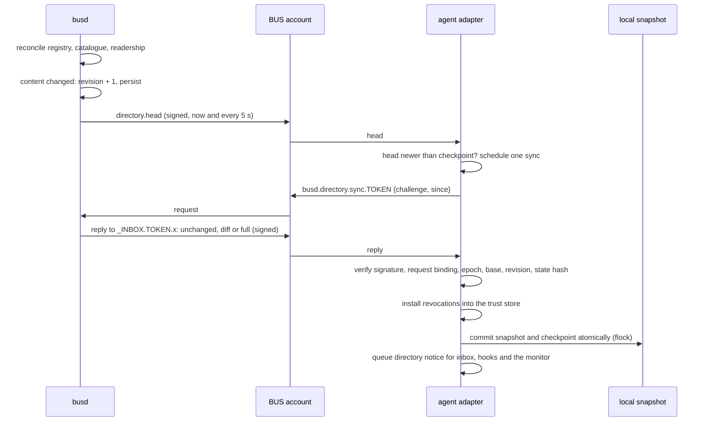

# Directory v2: versioned, announced, diff-only

Status: **built** (2026-11-25). This page is the one description of the protocol as it runs. It
replaces the once-a-minute full fetch over the enrollment login (commits 80c500a..8be64cd) and is
based on a design review by GPT 6.1 sol, with the owner's decisions below. How the build came
about is in [History](#history); the upgrade steps are in [Migration](#migration).

On this page, everything outside [Risks and open points](#risks-and-open-points) is implemented.

## Problem

Agents check senders and recipients against a local copy of the directory
(`~/.config/agent-bus/directory/`). The first fix fetched the whole directory from busd every
minute and on a miss, over the shared enrollment login. The owner wanted:

1. Updates noticed much sooner than once a minute, but a fetch only when something changed, and
   only the diff.
2. The protocol announces new agents.
3. No extra traffic just to check; piggyback on what is already sent.

## Decisions

| Question | Decision |
|---|---|
| Transport | The agents' own mTLS login in the BUS account. busd already has a BUS connection (`cmd/busd/main.go`, `bus-admin`). No enrollment login and no password file on agents. No account export/import. |
| Signalling | busd pushes a signed **head** (current version) on a subject agents subscribe to. Not presence: presence is fire-and-forget into a stream busd never reads, and beats only every 30 s. |
| Versioning | A version busd counts itself, not the registry KV revision. |
| Announcements | Net changes between versions, not every event. An agent that joins and leaves between two observations is never announced. |
| Recovery | A new epoch signed by the CA is accepted; all pins and revocations are kept and logged loudly. |
| Fallback | The one-minute check stays, as a conditional sync (normally "unchanged"), not a full download. |

## The protocol at a glance



Steps in words:

1. **Head.** busd announces the version it holds. A head is a hint; agents never install records
   from it.
2. **Conditional sync.** The agent asks from the version it has. busd answers `unchanged`, a
   `diff` from exactly that version, or the `full` directory.
3. **Verify.** The agent accepts the reply only if every check below passes.
4. **Atomic snapshot.** Records, catalogue and checkpoint are replaced in one file, under a lock.
5. **Notices.** The adapter tells the model and the monitor what changed.

## Version

```text
Version = { epoch, revision, state_hash }
```

- `epoch`: identifies this directory's lineage; new only after busd's state is lost or restored.
- `revision`: persistent, strictly increasing; advances only when the published content changes.
- `state_hash`: SHA-256 of a deterministic serialisation of the whole directory (records,
  tombstones, catalogue, readership).
- Timestamps are informational only, never used for rollback protection.

Why not the registry KV revision: catalogue changes live in another bucket, group readership comes
from BUS consumers (`internal/trust/directory.go`, `internal/broker/admin.go`), and a recreated or
restored bucket resets revisions. One published projection with its own counter avoids a version
vector.

The hash is over the normalised projection's JSON: records sorted by agent ID, readers sorted,
empty lists and maps written as `[]` and `{}`. Go's `encoding/json` is deterministic for that shape,
so busd and agents of the same release hash the same bytes.

## Subjects and permissions (BUS account)

| Subject | Who | Purpose |
|---|---|---|
| `directory.head` | busd publishes; agents and the monitor subscribe | Signed current version plus change hints |
| `busd.directory.sync.<agent-token>` | each agent publishes on its own (request); busd subscribes `busd.directory.sync.*` | Conditional sync: unchanged, diff or full |

- **Agents:** publish `busd.directory.sync.<own token>`, subscribe `directory.head` and their
  existing `_INBOX.<token>.>`. No KV write, no new JetStream API grants. Publishing `directory.head`
  needs busd's `bus-admin` login.
- **busd:** subscribes `busd.directory.sync.*`, publishes `directory.head` and replies to approved
  inbox prefixes only (no wildcards, no empty tokens, no reply outside the caller's inbox prefix).
- **The monitor** has a subscribe grant on `directory.head` (on `monitor-bus`) and nothing to
  publish.
- Sync is a public read: no authorisation on a claimed caller identity.

## Messages

All signed payloads use the `{payload, signature}` envelope: the CA key signs the exact payload
bytes, with a separate domain prefix per kind (`agent-bus/directory-head/v1\n`,
`agent-bus/directory-sync/v1\n`).

The JSON below shows the **decoded payloads**, and is schematic: hashes are shortened to readable
placeholders. On the wire the `payload` and `signature` fields of the envelope are byte strings, so
JSON carries them base64-encoded.

**Head** (busd to all, right after a change and then every 5 s):

```json
{
  "epoch": "e-2026-11-25",
  "revision": 42,
  "state_hash": "9f2c0b",
  "changes": [{"agent_id": "lib-x@bob", "kind": "joined"}],
  "truncated": false
}
```

| Field | Meaning |
|---|---|
| `epoch`, `revision`, `state_hash` | The version busd holds. |
| `changes` | Hints: agent IDs with `joined`, `removed` or `rekeyed`, and `channels` with the channel's name only (never its readers). At most 20 per head. |
| `truncated` | Set when more than 20 changes happened. |

busd signs a head once per revision and publishes it after every reconcile round, changed or not.
A head after a restart of busd carries no hints, since they were about a revision before it.

**Sync request** (agent to busd):

```json
{"challenge": "r4nd0m", "since": {"epoch": "e-2026-11-25", "revision": 39, "state_hash": "71ab3e"}}
```

An empty `since` asks for the whole directory.

**Sync response** (signed):

```json
{
  "request_hash": "c0ffee",
  "kind": "diff",
  "epoch": "e-2026-11-25",
  "from": 39,
  "base_hash": "71ab3e",
  "to": 42,
  "state_hash": "9f2c0b",
  "records": [{"agent_id": "lib-x@bob"}],
  "catalogue": {"team": ["lib-x@bob"]}
}
```

| Field | Meaning |
|---|---|
| `kind` | `unchanged`, `diff`, `full` or `error`. Errors are signed too; transport errors stay transport errors. |
| `request_hash` | Binds the reply to this request and its challenge: no replay of old snapshots, no clock dependence. |
| `from`, `base_hash`, `to`, `state_hash` | The diff's base and target version. |
| `records` | Complete current agent records for every agent that changed. In the example, the record is cut to its ID. |
| `catalogue` | Absent means unchanged; present and empty means empty. |

## Diff semantics

- A diff is the coalesced state change from `from` to `to`: complete current records for every
  agent that changed, the whole catalogue if it changed. Intermediate revisions are skipped.
- Removals are permanent tombstone records, including revoked-key history. Absence never means
  removal.
- busd keeps a cache of the last 16 projections, in memory only, to compute diffs. If the exact
  `(epoch, from, base_hash)` is not cached, it answers `full`. Losing the cache on restart costs
  one full fetch.
- An agent applies a diff only onto its exact base; otherwise it asks for a full sync.

## busd

busd keeps one projection and its version.

1. **Recover:** load the persisted projection and version from `<config-dir>/enroll/directory.json`.
   One busd is the only writer. A state file that cannot be read, or whose content does not match
   its state hash, counts as lost: the next projection starts a new epoch.
2. **Reconcile:** under the mutation lock, build a coherent directory from registry, catalogue and
   readership.
3. **Commit:** if the content changed, advance `revision` and persist projection and version
   (temporary file, fsync, rename, then the directory is synced) before the revision is announced.
4. **Publish:** announce the head; retry on failure and on reconnect. Re-announce every 5 s.
5. **Serve:** answer sync requests from the committed projection only.

Reconcile runs after every approval busd makes and every 5 s, waiting at most 2 s for the mutation
lock; a round that finds an approval running skips. There are no registry or catalogue watches:
the 5 s round catches agent-busctl's changes and the readership, which lives in consumers no watch
sees, so a watch would be a second path to the same result.

### What counts as published

Only completed enrollments are published. A registry record counts once its agent has its read
cursors on its DM channel and `general` and an account; a removed agent's tombstone always counts.

- The account counts only once the server runs with it. After a confirmed reload, `UpdateAuth`
  keeps a copy of the file it confirmed (`nats/auth.conf.confirmed`) and the check reads that
  copy, not `auth.conf`.
- A broker whose `auth.conf` has not changed since the server started has no copy and runs with the
  file itself. A rewrite without a reload (`init`, `admin init`) deletes the copy.
- busd marks an approval `approving` in `enroll/state.json`, on disk before it changes anything;
  the request's decision (approved, rejected or expired) clears it. While a pending request has it
  set, the agent is left out. This also covers a replacement or repeated enrollment, whose account
  exists already with the old certificate.
- A failed approval therefore announces nothing, and a restart of busd keeps that. The window that
  remains: after a failed approval of an agent that was published, the agent stays out of the
  directory until the owner approves again or rejects the request (at most the request's 24
  hours).
- The first attempt to approve a request records where the agent's read cursors start (in
  `enroll/state.json`). A repeated approval, after a restart too, starts them there, so nothing
  sent in between is skipped. The position is synced to disk before any registry or cursor change.

### Sync service

NATS does not tell the receiver who published a request, so each agent asks on a subject of its
own, `busd.directory.sync.<agent-token>`. busd serves `busd.directory.sync.*` on its `bus-admin`
connection and so knows the caller.

- **Reply subject.** busd answers only on a literal subject in that agent's inbox space,
  `_INBOX.<agent-token>.<token>...`. Anything else (another agent's inbox, another account
  subject, a wildcard, an empty token) is dropped, so a request cannot make busd's full-rights
  login publish anywhere else.
- **Limits.** Each agent: a burst of 5, then one a second. All agents together: a burst of 50,
  then one every 20 ms. Past a limit busd answers unsigned (`{"error": "..."}`), which the agent
  treats as a transport error, so a flood costs no signatures.
- **Errors.** A malformed request, and a request before busd's first projection, get a signed
  `error` reply.

## Agent

1. Load the committed local snapshot and checkpoint.
2. Subscribe to `directory.head`, flush, then sync.
3. On a valid head newer than the checkpoint: schedule one sync; further heads only raise the
   wanted version.
4. Fetch outside the adapter and trust locks.
5. Verify signature, request binding, epoch, base, increasing revision, record validity, and the
   resulting `state_hash`.
6. Commit snapshot and checkpoint atomically. Revocations go into the trust store (`revoked_keys`)
   after verification and before the commit, under the adapter's lock and with no network call.
7. Emit local directory notices and hand back held unknown-sender deliveries.

A sync also runs at start, on SIGHUP, on a miss (rate-limited to once per 5 s) and every minute as
the fallback. There is no reconnect hook: busd's head comes every 5 s, so after a reconnect the
next head says whether anything changed. Duplicate or reordered heads are harmless.

**New epoch.** An epoch signed by the CA is accepted, followed by a full sync; every pin and
revocation is kept and the change is logged loudly. A restore can never un-revoke a key or replace
a pinned key.

**Same version, other hash.** A head with the same epoch and revision but another state hash is
logged. The sync that follows asks from a version busd does not have and gets the full directory. A
full reply of the same epoch at the agent's revision with another hash is accepted (it is signed
and fresh).

**A diff that does not apply** (wrong base or a state hash that does not check) is not asked for
again from the same base: the agent asks once for the whole directory and takes that in.

### Unknown senders and one-shot commands

- A message from an unknown sender is not fetched for under the adapter's lock. It is left unacked
  and asks the directory loop for a sync (at most every 5 s). The sync then hands it back to the
  broker (a nak) as soon as the sender's record is in, so it is delivered at once.
- The adapter remembers such a message only by the way to hand it back (its ack subject), not its
  payload, which stays at the broker. At most 1000 are remembered, each for at most 10 minutes;
  one past the bound, or forgotten, comes back with the broker's next delivery after AckWait.
  None of it counts against the inbox's 8 MB.
- `send` and `publish` sync before taking the lock, for recipients missing from the directory.
- One-shot commands (`agent-bus send`, `inbox`, `mark-read`) have no loop: they sync on a miss, and
  `inbox` and `mark-read` sync and fetch again when a message waits for an unknown sender.
- The approval reply carries no directory (it is unsigned, and anyone with the shared login could
  overhear it and race a forged one in). `enroll` writes neither a directory nor the enrollment
  password; the agent syncs at its first start.

## Local storage

- One snapshot file, `<config-dir>/directory/snapshot`, holds records, catalogue, checkpoint and
  the remembered revocations. It is replaced atomically (temp file, fsync, rename, directory
  sync).
- Several identities share `<config>/directory`: a commit takes an flock on
  `directory/snapshot.lock` and rechecks the base under it. A commit whose base moved starts the
  sync over (three attempts).
- The per-agent `.json` files and `channels` are exports written from the snapshot after each
  commit. They stay the read path, so lookups are unchanged and records copied in by hand
  (`directory export`) keep working. An export is never deleted.
- `directory/snapshot.exported` notes the version the exports were finished for. At the adapter's
  start and after an `unchanged` sync it is compared, under the commit lock, with the snapshot's
  version, and the exports are written again if they differ. A crash between commit and export
  never leaves lookups on an older directory.
- The snapshot also keeps every key fingerprint any directory ever named revoked (`revoked`), and
  the exports mark those keys revoked. An identity that never ran when a key was revoked still
  refuses it, and a restored busd that offers the key unrevoked cannot bring it back. The
  projection itself stays busd's, so its hash still checks.
- Pins and remembered revocations are untouched by a sync; a signed new key does not replace a
  pin.

## Groups

After every sync the adapter recomputes the channels it reads from the synced catalogue (plus
`--groups`), under its lock; the reader picks them up at its next poll. A join needs nothing else on
the agent's side: the read cursor exists (busd or agent-busctl made it, which is how the catalogue
lists the reader), and the grants for every catalogued group came with `channel create`. A group
left is dropped from the set.

## Announcements to the model and the monitor

**Notices.** The adapter computes the notice from the directory it knew and the one it took in,
so it is the net change and comes once per version; the heads' hints play no part.

- Content: joined, removed and rekeyed agents, and channels from the agent's point of view ("you
  now read channel team", "channel x is new"). A new epoch is said too. At most 10 wait; the oldest
  go first.
- The first sync summarises the directory; it does not announce every existing agent as new.
- `inbox` and `wait_for_messages` carry them as `directory_notices`, apart from `messages`; each
  is shown once. The hooks add them to a mail notice (Stop, the idle waiter, the plugin) and to the
  session start's summary, under "Agent Bus directory (from your adapter, nothing to answer)".
- A notice alone does not end `wait_for_messages`, block a Stop or wake an idle session: one
  enrollment would otherwise cost every idle agent a turn. It waits for the next result or notice
  (a wait times out within at most five minutes).
- A notice taken for the plugin's notice is gone even if the plugin fails to deliver it; it is
  informational, and the directory itself is right.
- The MCP instructions do not mention them, to keep the briefing within its budget; the field's
  name and the text ("Directory updated: ...") say what they are.
- "Registered" is not "online": presence stays separate.

**Monitor.** The monitor subscribes to `directory.head` and, on a CA-signed head naming a new
version, runs its discovery round at once; the 5 s round stays as backup. It does not use
`busd.directory.sync`: it already reads the registry and the catalogue from busd over
`monitor-control` (`busd.monitor.*`), which has what it shows (removed agents included).
`GET /api/v1/status` has `directory`: the version busd last announced, when, and the error of the
last registry or catalogue read, apart from presence. The page shows "directory not readable"
while that error is set.

## Failures and recovery

| Failure | What happens | Recovery |
|---|---|---|
| busd is down | Agents keep their cached directory; revocations reach them only when busd is back. A maximum staleness policy is not defined. | Start busd; the next head and sync catch up. |
| Head lost or reordered | Harmless; the next head (within 5 s) and the one-minute fallback cover it. | None needed. |
| Reply lost or sync times out | Transport error; the agent keeps its snapshot. | Retry at the next head or the minute fallback. |
| Request flood | busd answers unsigned past the per-agent or total limit. | The agent sees a transport error and retries later. |
| Diff does not apply (wrong base, bad hash) | Not asked again from that base. | One `full` sync (`since` empty). |
| busd's diff cache lost (restart) | busd cannot find `(epoch, from, base_hash)`. | Answers `full`: one full fetch. |
| busd state file unreadable or hash mismatch | Treated as lost. | A new epoch; agents accept it if CA-signed and keep pins and revocations. |
| busd restored from a backup | Old epoch with a lower revision; agents refuse it as a rollback. | Delete `enroll/directory.json` after the restore so a new epoch starts. |
| Same epoch and revision, other hash | Logged as a fault. | Full sync. |
| Crash between snapshot commit and export | Lookups could be on an older directory. | `snapshot.exported` is compared at start and after `unchanged`; exports are rewritten. |
| Two processes commit at once | The second finds its base moved. | Sync starts over under the lock (three attempts). |
| Approval fails half way | Agent not yet published (or left out while `approving` is set). | Owner approves again, or rejects, or the request expires after 24 h. |
| Sender unknown on a message | Message left unacked. | Sync requested; nak hands the message back once the record is in. |

## Migration

Nothing from the first fetch was released, so it (`busd.directory` on the enrollment login, the
password file on agents) is removed rather than kept for compatibility.

- busd and agents must both run v2. An older agent keeps working with its local directory but
  needs the manual `directory export` copy to learn new agents.
- The broker auth files must be regenerated for the new BUS grants.

Upgrade steps for the owner (also in [docker.md](../docker.md#upgrade)):

1. Deploy busd (the broker image) and the agents' `agent-bus` of the same release together: an old
   agent never syncs, and an old busd answers no sync (agents then log "busd is not running" and
   keep their local directory).
2. Regenerate the auth files once: `agent-busctl --direct init` (with the retention flags, if they
   were changed). It gives agents publish `busd.directory.sync.<own token>` and subscribe
   `directory.head`, the monitor subscribe `directory.head`, and drops `busd.directory` from the
   enrollment login.
3. Restart the agents' sessions. Each starts with a conditional sync (the full directory when it has none, otherwise a diff or `unchanged`), then follows the heads.
4. Delete `<config-dir>/enroll/password` on agent machines, which the first version's `enroll` left
   there.
5. Agents of an older release that must stay: keep copying `directory export` to them.
6. After restoring busd's config folder from a backup, delete `enroll/directory.json` so that busd
   starts a new epoch; agents refuse an older revision of the same epoch.

## Risks and open points

Not built, or known limits.

- **Revocation delay while busd is down:** a maximum staleness policy is not defined.
- **Metadata in BUS:** heads expose revision numbers and join, leave and rekey events to every BUS
  reader. Hostnames, pending approvals and private group membership stay out of the hints.
- **Abuse:** signatures stop forgery, not flooding. The signing budget is limited per agent, but
  the requests of all agents share one wildcard subscription and its callback in busd, so a flood
  from one authenticated agent can still delay the others' syncs (trusted LAN, MVP: not fixed).
- **Scale:** large snapshots may later need paging with a signed manifest; never apply part of
  one.
- **Key separation:** the CA key signs directories for now. A dedicated directory key, certified
  by the CA, is a later hardening.
- **Single busd:** active/active busd would need shared fencing for version allocation.

## History

The design came from a review of the first fetch. Findings of that review and where each was fixed:

| Finding | Fixed by |
|---|---|
| Approval reply's directory is unsigned and its IDs unchecked (path traversal) | ID validation in `FileDirectory.Write`; the reply carries no directory now |
| A fetch on a miss does not install revocations | Agent step 6 |
| Snapshot and checkpoint not atomic, not serialised across processes | Local storage |
| `issued_at` is a weak freshness and version check | Version plus challenge |
| Signed directory is not a coherent cut | busd steps 2 and 3 |
| Network fetch while holding the adapter lock | Agent step 4 |
| A running agent added to a group does not read it until restart | Groups |

It was built in eight commits:

1. Version and projection in busd: reconcile, commit, persist.
2. `busd.directory.sync` on BUS with signed `unchanged`, `diff` and `full` replies; grants. A first
   draft used one shared subject and any well-formed agent inbox; review changed it to one subject
   per agent and literal reply subjects.
3. `directory.head` announcements, every 5 s and on change.
4. Agent: snapshot file with cross-process lock, verify and apply, revocations installed;
   subscribe to heads; v1 and the password file removed.
5. Group subscriptions follow catalogue changes without restart.
6. Directory notices in `inbox`, `wait_for_messages` and hooks.
7. Monitor: refresh on heads; sync status shown.
8. Docs.

Decisions the build made against the first text: no registry or catalogue watches in busd (the
5 s round suffices), no reconnect hook in the agent (heads come every 5 s), and the monitor does
not use the sync subject.
