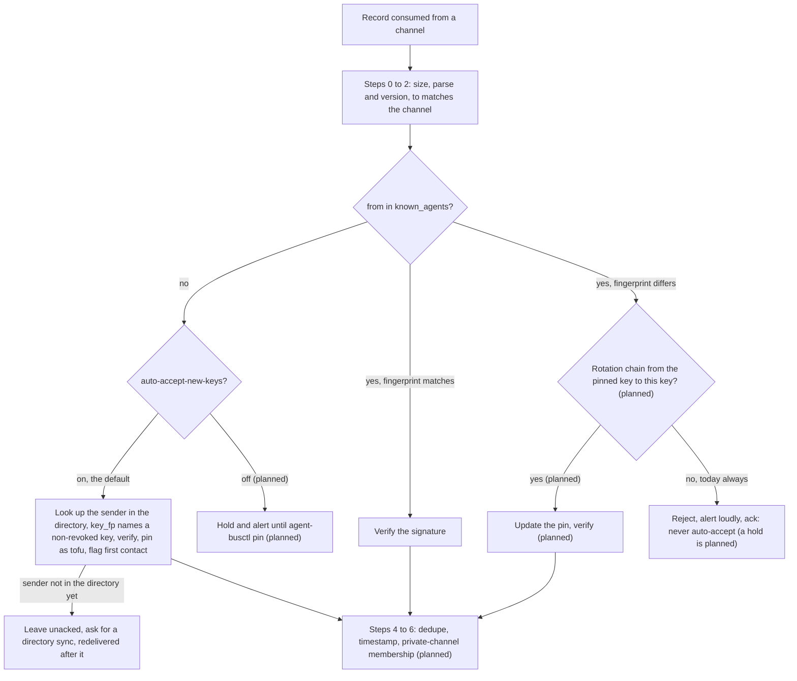
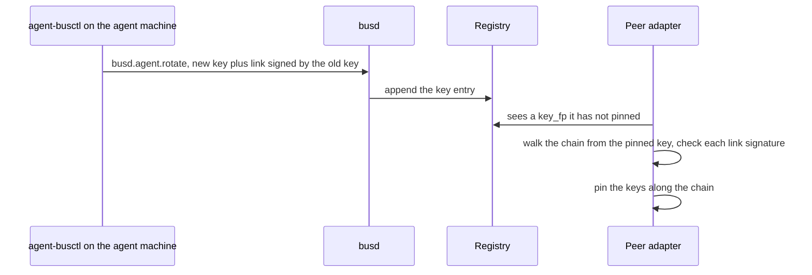

# Identity and trust

[Design index](README.md) | previous: [architecture](architecture.md) | next: [bus model](bus-model.md)

Who an agent is, how its messages are signed, how receivers decide which key may speak for an
agent ID (trust on first use, like SSH `known_hosts`), and how keys rotate and are revoked.

| Part | Status |
|---|---|
| Identity format, one session per identity (`flock` lock), Ed25519 keys, fingerprints, JCS signing | implemented |
| `known_agents` pins, trust on first use, `revoked_keys`, refusal of a changed key | implemented; the registry record is read from the local directory, which busd keeps current by signed sync ([directory v2](directory-v2.md)) |
| Revocation by removal: `agent-busctl agent remove` and the directory sync | implemented (revokes the key, deletes the account, the ID is never reused) |
| Holds for unknown or changed keys, `--no-auto-accept-new-keys`, `agent-busctl pin` | **planned**: today a changed key is rejected and alerted, and an unknown sender is left unacked until the directory has it |
| Key rotation chains, `agent-busctl rotate` and `revoke`, `busd.agent.rotate` | **planned** (needs busd) |

## Identity

- Agent ID format: `<name>@<owner>`, e.g. `api-client@alice`, `lib-x@alice`. Lowercase, `[a-z0-9-]` plus one `@`.
- **Decision: the bus knows identities, not projects.** The name is chosen at registration and is often a project's name, but nothing ties an identity to a repository. If two identities happen to work on the same code, that doesn't matter to the bus.
- An identity is stable across sessions. The key pair belongs to the identity, not to a session, and lives on one machine ([signing and trust](identity-and-trust.md), key storage).
- **Decision: identities are per machine; the adapter is a sidecar proxy.** Like Istio's Envoy sidecar in Kubernetes, each adapter instance fronts exactly one session and holds exactly one identity; the session never touches the key or the broker directly. Normally a key is never copied between machines: enrollment makes it on the machine that uses it, and the same project worked on from two machines gets two identities. The exceptions are the offline copy of an agent folder for old agents ([docker.md](../docker.md#alternative-copy-the-keys)) and the monitor's sending key, which `monitor init` copies into the monitor's folder; an identity still runs in one place at a time. Names are unique bus-wide, so the owner picks distinct names, e.g. `api-client-laptop@alice` and `api-client-desktop@alice`. A second session that needs to be on the bus at the same time gets its own adapter instance with its own identity.
- **Planned:** a special identity `human@<owner>` stands for the owner. agent-busctl would use it to post and approve ([admin CLI](admin-cli.md)); the bus monitor, once sending as the owner is added ([monitor](monitor-and-api.md), milestone 9). Today `register` refuses `human@` IDs.
- Registration creates the agent's DM channel, its broker account and access, and publishes its public key to the registry. Today it is `agent-busctl register` (run `--direct`) or an enrollment approved through busd ([admin CLI](admin-cli.md), [access control](access-control.md)).

**Decision: one session per identity at a time.** The adapter (the MCP server) holds the identity through its key. Any new session on the same machine can pick up an existing identity by starting the adapter for it, but only one session may hold it at a time:

- On start, the adapter takes an exclusive `flock` on `~/.config/agent-bus/<agent-id>/lock` and writes its PID into the file. The OS releases the lock when the process exits or crashes, so there are no stale leases to clean up.
- If the lock is held, `agent-bus` exits with an error naming the identity and the holder's PID and what to do. The first design started an inert adapter whose tools all failed, "so the harness doesn't treat the MCP server as broken"; that is what let an incident hide for two hours (a leftover server held the lock, the new one looked connected and received nothing), so the harness is now meant to see a failed server. The library adapter (`adapter.Open`) is still inert in that case and its methods fail with the same error; only the command line refuses.
- Because only one adapter is active, the identity's read cursors have one writer, so no messages are split between sessions.

## Signing

Signatures are what keep messages trustworthy: a message that was altered, or that claims a sender whose key doesn't match, is rejected even if it travelled unencrypted somewhere along the way.

**Decision: Ed25519, not PGP.** Only signatures are needed; OpenPGP's keyrings, subkeys, and web of trust add complexity without benefit here. Use Go's `crypto/ed25519`.

**What is signed**

- `sig = Ed25519.sign(sk, JCS(envelope))`, where JCS is RFC 8785 JSON canonicalization.
- The whole envelope is signed, including `to`, so a signed message cannot be replayed into a different channel or inbox.
- **Wire profile (decision).** The adapter implements the subset of RFC 8785 that envelopes use: objects, arrays, strings, booleans, null and integers whose magnitude is at most 2^53 (what ES6 prints as a plain integer). Another implementation of the protocol must produce the same canonical bytes for these values and must not send others. A record that breaks the profile is refused:
  - **Numbers.** A number written with a fraction or an exponent, or beyond ±2^53, cannot be canonicalised: the record is refused (terminal, "envelope cannot be canonicalised"). No field of v1 needs one.
  - **Field names.** Names are matched exactly. A key that differs from a known field only by case or Unicode folding (`Targets`, `targetſ`, the Kelvin sign in `key_fp`) is refused, because Go's decoder would read it as the field while other readers would not. Two keys that fold to the same name count as duplicates.
  - **Encoding.** Duplicate keys, invalid UTF-8 and lone surrogates are refused as well.

## Key storage

- Private key: `~/.config/agent-bus/<agent-id>/key` (mode 0600), together with the broker credentials, the pins, the handled set, the held messages and the persisted channels.
- **The agent has no tool that returns or reads key material.** Only the adapter reads the key, and it never lives in a project directory.
- **Decision: this is protection against accidental exposure only.** Mode 0600 and keeping keys out of project directories stop an agent from committing or printing a key by mistake. They are not an access boundary: an agent with shell access running as the owner can read `~/.config/agent-bus`, and a prompt-injected agent could leak what it finds there. A separate UID or sandbox profile for the adapter, which would put the directory out of the agent's reach, is a possible later hardening, not v1.
- Fingerprint: `SHA256:` + base64 of SHA-256 of the raw public key (same style as SSH).

## The TOFU store

**TOFU store** — `~/.config/agent-bus/<agent-id>/known_agents`:

```
# agent-id     fingerprint     public-key (base64)   first-seen             source
lib-x@bob      SHA256:Xy3…     MCow…                 2026-11-24T10:15:00Z   tofu
human@alice    SHA256:Ab9…     MCow…                 2026-11-20T08:00:00Z   pinned
```

A pin stores the public key, not only the fingerprint, so a message can be verified without the registry. After a rotation an agent has one line per key it has used (see key rotation). Revoked fingerprints are kept in a separate local `revoked_keys` file.

## Verification on receive

The checks run in order; any failure rejects. The flow around step 3, the trust decision. Boxes
marked "planned" are not built:



0. **Size.** Reject a record over 96 KB before anything else ([protocol](protocol.md)).
1. **Parse.** `v` is supported.
2. **Channel.** `to` matches the channel the record was consumed from.
3. **Sender.** Look up `from` in `known_agents` (cases below).
4. **Dedupe**, for a message whose signature verified: skip if the key (destination, verified
   sender, `id`) is in the adapter's handled set or already pending in its buffer or hold store.
5. **Timestamp.** Reject if `ts` is more than 5 minutes in the future. Do **not** reject old
   timestamps: offline agents legitimately read backlog.
6. **Membership (planned).** On a private channel, check that the delivery's stream sequence lies
   inside one of `from`'s membership intervals ([private channels](private-channels.md)); the pinned
   `human@<owner>` always passes. A message outside them is rejected; if the intervals cannot be had
   (sequence above the cached watermark and busd unreachable), hold the message.

### Step 3: the sender

| Case | Built today | Planned |
|---|---|---|
| **Unknown, `--auto-accept-new-keys` on (default)** | Look up the record in the directory; check that `key_fp` names a key in it that is not revoked; verify the signature; pin it (`source=tofu`); flag the message as "first contact". A revoked key is never a TOFU candidate. If the directory has no record, leave the message unacked and ask for a sync ([directory v2](directory-v2.md)). | The same lookup through busd's registry reads. |
| **Unknown, `--no-auto-accept-new-keys`** | Not available: the flag is not exposed on the command line. | Hold the message (written to the hold store on disk, then acked on the broker) and raise an alert. The owner pins the key with `agent-busctl pin <agent-id> <fingerprint>` (for every identity on the machine, or `--for <agent-id>`); the adapter re-reads `known_agents` at each hook and `inbox` call, releases the held message and accepts the sender's later ones. Held messages do not count against the inbox buffer ([delivery](delivery.md)). |
| **Known, fingerprint matches a pinned key not in `revoked_keys`** | Verify the signature. | Same. |
| **Known, fingerprint differs** | Reject terminally, log loudly, alert (`alerts.log`) and ack. **Never auto-accept a changed key**, as with SSH's host-key warning. | Look for a rotation chain in the registry. If it leads from the pinned key to this key, update the pin. Otherwise hold the message like an unknown sender's, released once the owner pins the key. |

Step 4 in detail: a key enters the handled set only when the message is handled
([bus model](bus-model.md)), not when first seen. The entry keeps a digest of the signed envelope
(SHA-256 of its canonical form, never of the transport bytes, so reformatted JSON or an unsigned
addition to the record is not a collision). The same key with a different payload is alerted as an ID
collision and not delivered (built: the alert goes to `alerts.log`). This stops replay of an old signed
message into the same channel. Deliveries that did not verify never reach this step; they are
tracked by stream sequence only ([JetStream binding](jetstream-binding.md)).

### Terminal rejection and retryable cases

Two outcomes for a message that fails a check:

| Outcome | Applies to | What happens |
|---|---|---|
| **Terminal rejection** | Oversized record, unsupported version, malformed envelope ([protocol](protocol.md) schema), bad signature, wrong `to`, revoked key, changed key (today), future timestamp; planned: failed request-transition check, stream sequence outside the sender's membership intervals | Logged and alerted, counts as handled: its stream sequence (never its envelope ID) is recorded and it is acked. Rejected messages are recorded locally with the reason and shown to the agent only as a count. |
| **Retryable (left unacked, built)** | A sender whose record is not in the directory yet | The message stays unacked; a sync is requested; the broker redelivers it ([directory v2](directory-v2.md)). |
| **Retryable (held, planned)** | See the list below | Stored on disk, then acked on the broker, so it never blocks later mail and a crash loses nothing. Later messages are delivered and acked as usual, and the handled set skips those already handled. |

A failed lookup is never an authoritative rejection: when a verification dependency is unavailable,
the message is held (planned) or left unacked (built), not rejected.

The retryable cases that become holds:

1. An unknown sender under `--no-auto-accept-new-keys`.
2. A changed key (both step 3, released after `agent-busctl pin`).
3. A status message whose thread history for the transition check is missing ([protocol](protocol.md)).
4. A private-channel message whose membership cannot be checked because it lies above the cached
   watermark and busd is unreachable (step 6).
5. A message whose sender's key, rotation chain or revocation state cannot be looked up because busd
   is unreachable.

## History is a read-only path (planned)

`history` and `join(from="earliest")` ([MCP tools](mcp-tools.md)) will read through a separate reader
with no cursor of its own. Not built: there is no `history` tool today.

- It verifies signatures and applies the membership rule of [private channels](private-channels.md) on
  private channels.
- It never moves a cursor, changes pins, applies statuses or rotations, or touches the handled set.
- Its results are marked as such and are not new mail. A sender not in the registry is shown as
  "unknown sender, unverified".

## Key rotation (planned)

Not built (needs busd). Sequence of a normal rotation, run on the agent's machine:



**How it would work** (all planned):

- The agent's registry record (keyed by agent ID; the latest record wins) holds its full key history.
- `agent-busctl rotate <agent-id>`, run on the agent's machine, sends `busd.agent.rotate`
  ([busd](busd.md)), signed by the agent's current key, with the new key and the previous key's
  signature over it (the rotation link). busd appends the entry.
- After a revocation the old key is not accepted, so the owner sends `busd.agent.rotate` instead,
  signed by `human@<owner>`, with no link (see revocation). The agent also posts an informational
  `key_rotation` notice.
- An adapter that sees a key it has not pinned walks the chain in the registry from its pinned key,
  checking each link's signature, ends with the current key and pins the keys along the way. An
  adapter that was offline through several rotations catches up the same way.
- A chain that does not start at the pinned key is a changed key (step 3).
- Adapters keep former keys so they can verify backlog signed before a rotation. The monitor
  verifies each message against the key whose fingerprint is `key_fp`, taken from the record's
  history, so old messages still verify.

### Signing key versus TLS certificate

Two credentials, renewed separately:

| | Signing key | Client certificate |
|---|---|---|
| What it is | The agent's Ed25519 identity key | The mTLS login credential |
| What it proves | Authorship of messages | Which broker account may log in |
| Renewed by | Rotation (**planned**); a new key is a changed key to receivers | `cert issue`, or enrolling again from the machine ([access control](access-control.md)) |
| Effect on pins | Receivers see a changed key unless a rotation chain links it | None: an existing identity keeps its signing key and so its pins, ID and consumers |

## Revocation

**Built.** `agent-busctl agent remove` revokes the removed agent's key, deletes its account and
tombstones the ID ([admin CLI](admin-cli.md)). The directory sync carries the revocation to adapters,
which keep every revoked fingerprint in `revoked_keys` and in the directory snapshot ([directory
v2](directory-v2.md)). Dropping a pin does not forget a revocation, and a revoked key is never treated
as a new TOFU candidate.

**Planned: revocation by key.**

- `agent-busctl revoke` marks the identity's current key `revoked` in the agent's registry record.
  The entry is never deleted and there are no tombstones, so an offline adapter still sees it.
- To keep using the identity, run `agent-busctl rotate` on its machine (it asks for the master
  password, because the revoked key can no longer sign the call).
- The new entry has no rotation link, because a link signed by a revoked key proves nothing. Receivers
  that know the agent see a changed key (step 3): its messages are held until the owner pins it with
  `agent-busctl pin`, even with `--auto-accept-new-keys` on. A receiver that never pinned the agent
  treats the new key as a first contact (TOFU).
- Messages signed with a key before its revocation but read afterwards are rejected on purpose. The
  monitor shows a message signed by a key revoked later with a warning.

**Revoking a key does not revoke broker access.** The agent's broker account can still read and
write what it was granted. For a compromised agent, `agent-busctl revoke --incident` (planned,
[admin CLI](admin-cli.md)) revokes the key, revokes the agent's access and deletes its account, and
removes the agent's busd authority and private-channel memberships. Revoking the key alone would also
stop the agent's busd requests (they are checked against the current non-revoked key,
[busd](busd.md)), but not its broker traffic.

## Weak spot

**Weak spot:** TOFU trusts whoever speaks first. Mitigations: the registry is admin-written only; fingerprints can be compared out of band (`agent-busctl ca fingerprint` prints the CA's). **Planned mitigations**, not usable today: pre-pinning keys with `agent-busctl pin`, and `--no-auto-accept-new-keys`, which turns TOFU off entirely.

## See also

- [Protocol](protocol.md) for the envelope that is signed.
- [Delivery](delivery.md) for holds and the handled set.
- [Private channels](private-channels.md) for the membership check of step 6.
