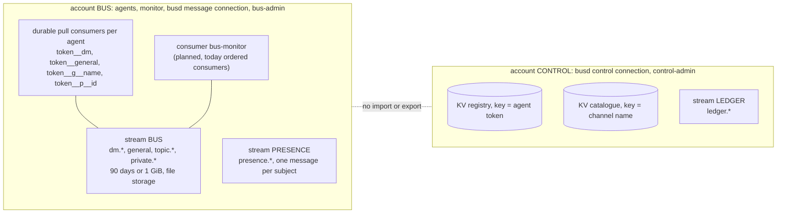

# NATS JetStream binding

[Design index](README.md) | previous: [bus model](bus-model.md) | next: [protocol](protocol.md)

How the [bus model](bus-model.md) maps to NATS JetStream. Everything NATS-specific is here and in
`internal/broker`. The grants of each role are in [access control](access-control.md); the
server configuration and reloads are in [operations](operations.md); consumers and acks are in
[delivery](delivery.md).

| Part | Status |
|---|---|
| Two accounts `BUS` and `CONTROL`, streams `BUS`, `PRESENCE`, `LEDGER`, KV `registry` and `catalogue`, naming, `Nats-Msg-Id` dedupe (24 h window) | implemented in the broker layer; `LEDGER` exists but nothing writes it yet |
| Consumers provisioned by an admin | implemented by `agent-busctl --direct` (register, `channel join`) and by busd (enrollment approval, channel requests); busd takes over the rest later |
| The directory served to agents by busd: signed head and sync ([directory v2](directory-v2.md)) | **implemented**; the `directory/` files and `channels` export are written from it |
| Registry, catalogue and history served to agents by signed busd methods (`busd.history`, `busd.registry.get`, ...) | **planned** |
| Private-channel subjects `private.<id>` and the ledger | **planned** |

## From identity to consumer: an example

How one agent's names map, with the neutral cast of these docs:

| Step | Value |
|---|---|
| Agent ID | `lib-x@bob` |
| Agent token (`@` becomes `_`) | `lib-x_bob`, also the NATS user name in password mode (a certificate login is named `agentbus:agent/lib-x_bob/<certID>`) |
| DM subject | `dm.lib-x_bob` |
| Consumers | `lib-x_bob__dm` on `dm.lib-x_bob`, `lib-x_bob__general` on `general`, `lib-x_bob__g__team` on `topic.team` for a group `team` |
| Directory sync subject | `busd.directory.sync.lib-x_bob` |
| Reply inbox prefix | `_INBOX.lib-x_bob.>` |
| Presence subject | `presence.lib-x_bob` |

So the password login `lib-x_bob` (or its certificate equivalent) may publish to `dm.*`, `general` and `topic.*`, pull from exactly its own
consumers, and subscribe only to its own inbox space and `directory.head`
([access control](access-control.md#current-grants-built)).

## Layout at a glance

**Decision:** NATS JetStream (Apache 2.0, CNCF), run as `nats-server` v2.15.3 in its own process, with the Go client `github.com/nats-io/nats.go` v1.56.0 (`jetstream` package, pure Go). One owner needs no JWT accounts or `nsc`: the server's authorization config lists static users with passwords and per-user subject permissions, in two static accounts (below).

### What was proved, and how

| Evidence | What it covers |
|---|---|
| The spike (a throwaway program against a real server) | TLS with the private CA; static users with per-user subject permissions; per-agent consumers with a pinned filter in the create subject; per-message acks (B before A, redelivery after `AckWait`, state kept across a server restart); `NakWithDelay` surviving a restart; `Nats-Msg-Id` dedupe; retention limits; KV compare-and-set; a plain stream next to KV; core request/reply; runtime permission change by reload (live grants change, a removed user is disconnected); a denied JetStream call shows up only as a timeout plus an async error |
| The milestone 1a integration test (`make itest`, against a real server) | The two-account setup; per-role grants with no consumer create, delete or update; `MaxDeliver` -1 and `MaxAckPending` at 500; `Nats-Expected-Last-Subject-Sequence` on `LEDGER`; reload confirmation through the monitoring endpoint; the stream sequence in the delivery metadata; the admin reading the stream's last sequence; the raw-NATS part of the [acceptance tests](acceptance-tests.md) reply-destination tests |
| Not proved yet | busd serving history; the signed-busd parts of those tests (nonces, method checks, idempotency), which belong to milestone 3 ([milestones](milestones.md)) |

**The redirect result.** A record pulled onto a subject of `BUS` through a reply subject is
delivered to whoever listens there but is **not** stored again (the stream's message count and last
sequence stay the same). Only JetStream API responses sent to a reply subject are stored, with the
server's payload.

## Two accounts

**Two accounts.** NATS delivers JetStream responses to a reply subject the *caller* names, and the permissions only check the request subject. So any user in an account that can call a JetStream read API or pull from a consumer can make the server write a stored payload to any subject of that account, `$KV.*` and `ledger.*` included. Authoritative data therefore lives in a second account, which no agent can reach. (Within one account the redirect writes only JetStream API responses, with the server's payload; a pulled record is delivered but not stored again, as the integration test showed.)

- **`BUS`:** stream `BUS` (every conversation channel), agents, the monitor's read-only user, busd's message connection, and the owner's posting user.
- **`CONTROL`:** the KV buckets `registry` and `catalogue`, and stream `LEDGER`. The logins in it are `busd`, `control-admin`, `monitor-control` and the shared `enroll` login. There is no import or export between the accounts.

Agents never touch `CONTROL`: busd serves what they need over request/reply ([busd](busd.md)). Today its signed replies (directory sync, channel requests) are signed by the CA key; a dedicated busd service key for every reply is planned. Neither account lets an agent create a resource, a consumer included.

## Naming

**Naming.** Alphabets: an agent ID is `[a-z0-9-]+@[a-z0-9-]+`. Its *agent token* replaces `@` with `_` (`lib-x@bob` → `lib-x_bob`; `human@alice` → `human_alice`), so a token has exactly one `_`. A group channel name is `[a-z0-9-]+` and a private channel ID is 26 characters `[a-z2-7]`. No name contains `__`, so the parts of a consumer name split unambiguously at `__`. One function does the mapping. The token is the NATS user name in password mode (certificate mode: `agentbus:agent/<token>/<certID>`) and the DM subject suffix. A private channel's subject carries an opaque ID chosen by busd, never the channel's name ([private channels](private-channels.md)).

| Channel | Where | Retention |
|---|---|---|
| registry | `CONTROL` KV bucket `registry`, key = agent token | latest per key (KV history of up to 64 is a bonus; `AgentRecord` already holds the key list) |
| `general` | subject `general` in stream `BUS` | `MaxAge` 90 days, `MaxBytes` 1 GiB of `BUS` (set by `agent-busctl init`) |
| group channel `<name>` | subject `topic.<name>` in `BUS` | `MaxAge` 90 days, `MaxBytes` 1 GiB of `BUS` (set by `agent-busctl init`) |
| DM `<agent-id>` | subject `dm.<agent-token>` in `BUS` | `MaxAge` 90 days, `MaxBytes` 1 GiB of `BUS` (set by `agent-busctl init`) |
| private channel `<channel-id>` | subject `private.<channel-id>` in `BUS` | `MaxAge` 90 days, `MaxBytes` 1 GiB of `BUS` (set by `agent-busctl init`) |
| catalogue | `CONTROL` KV bucket `catalogue`, key = channel name | latest per key |
| membership ledger (**planned**, busd only, [private channels](private-channels.md)) | `CONTROL` stream `LEDGER`, subjects `ledger.>` | unbounded: `MaxAge=0`, `MaxBytes=-1` |

**Stream `BUS`.** One stream over `dm.>`, `general`, `topic.>` and `private.>` (streams cannot overlap subjects). File storage, limits retention with `MaxMsgs=-1`, and `MaxAge` and `MaxBytes` set by `agent-busctl init`: 90 days and 1 GiB by default. `--max-age 0` keeps messages forever and `--max-bytes -1` sets no size limit ([bus model](bus-model.md#retention)). Only the `LEDGER` stream is unbounded by design.

## Channels exist in the catalogue, not in the broker

Group channels exist when they are in the catalogue ([bus model](bus-model.md)); a DM channel exists
when its agent is registered. Consumers exist only for these channels, and the adapter refuses to
publish to a channel that is not in the catalogue (or to an unregistered agent).

**Built:** agents learn the catalogue from the signed directory sync ([directory v2](directory-v2.md)).
`agent-busctl channel create`, `channel join` and `directory export` still write the `channels` file
in the local directory (each group with the agents that hold a read cursor on it); the adapter's
sync writes the same file from the snapshot.

- The adapter reads it at start to subscribe to the groups that list it (`--groups` adds more, so it
  is optional).
- It refuses to publish to a group it neither reads nor finds in the file ("unknown channel").
- It warns in the result when an explicit target is not listed as a reader, because a message to a
  channel its target does not read is never seen.

The broker does not enforce this: a misbehaving agent with the `topic.*` or `dm.*` publish grant can
still append to an uncatalogued subject, but no consumer reads it and nobody receives it. **Planned:**
`history` (served by busd) will refuse such a subject too.

## Order

**Order.** The canonical order of a channel is the stream sequence. A first delivery follows it; a redelivery (after a crash, an `AckWait` expiry or a reconnect) can arrive after later messages. The promise of [bus model](bus-model.md) is therefore canonical order for reading history, and first-delivery order otherwise.

- **Listing.** The adapter exposes the sequence as `seq` on every message it lists, and the inbox lists messages in stream order.
- **Priority.** Targeted mail is prioritised by thread: a thread with a message for the agent is listed first. The messages of one thread are never reordered, so an untargeted parent is not listed after the targeted reply to it. Messages of different threads or channels are only loosely ordered by that priority.
- **What must be exact.** Anything that must be order-correct, such as folding request status changes ([protocol](protocol.md)), uses the stream sequence from authoritative history, never arrival order. The stream sequence is also what private-channel membership is checked against ([private channels](private-channels.md)).

## History (planned)

**Planned; not built.** There is no history consumer. `history` and `join(from="earliest")` ([MCP tools](mcp-tools.md)) are served by busd over request/reply (`busd.history`): busd checks that the caller may read the channel (open and catalogued, its own DM, or a private channel it belongs to; the owner and the monitor identity may read all). A *thread* history read of a DM thread returns the records of that thread from both participants' DM channels, merged by stream sequence, to a participant (sender or recipient of the thread's records), and, as for every channel, to the owner and the monitor identity, so a DM request split across two DM channels can be rebuilt after a restart. busd reads `BUS` by an ordered consumer of its own, and returns a page of records with their stream sequences, bounded by NATS's maximum payload, with `before` as a stream sequence. The reply is signed by busd; the adapter still verifies each record's signature and, on a private channel, applies the membership rule of [private channels](private-channels.md) to each stream sequence ([signing and trust](identity-and-trust.md)). It moves no read position.

## Dedupe

**Dedupe.** The adapter publishes with `Nats-Msg-Id` set to the canonical destination subject plus the envelope ID (`jetstream.WithMsgID`), so an ID reused on another subject is not mistaken for a duplicate. The stream's `Duplicates` window is set explicitly to 24 hours (it must not exceed `MaxAge` if one is ever set). This is bounded, best-effort suppression of the adapter's own retries; it is not authorization, and a retry after the window appends a second record. Envelope verification and the handled set ([signing and trust](identity-and-trust.md) step 4) stay in force. `LEDGER` relies on busd's operation intents instead (below).

## Registry, catalogue and ledger

- Only busd (and `agent-busctl --direct`) writes the registry and the catalogue. Writes use compare-and-set (`Create` / `Update` with the revision). **Built.**
- **Planned:** the membership ledger ([private channels](private-channels.md)) is a plain stream, not KV: KV keeps at most 64 revisions per key and the ledger is an append-only log. An operation is published to `ledger.channel.<id>` with `Nats-Expected-Last-Subject-Sequence` set to the version it expects, so the broker refuses a stale one. The ledger also holds the group join boundaries, the reload generations (below) and busd's operation intents. Every confirmed join, removal and group join entry carries the `BUS` stream's sequence at that moment ([private channels](private-channels.md)). An operation intent, `ledger.idem.<caller-token>.<idempotency-id>`, is created once (expected last sequence 0) *before* any effect, with the hash of the semantic request and every resource ID busd assigned (a new channel's ID, say). Recovery finishes that same operation; the result is derived from the operation's confirmation events ([busd](busd.md)). This works beyond the dedupe window and covers every mutating busd method.
- busd reads the registry through its own reader today; reading the ledger is planned.

## A denied call is a timeout

**A denied call is a timeout.** JetStream answers a call the server refused only by silence: the client sees a timeout, and the real reason arrives asynchronously as a permissions error on the connection. The adapter therefore makes every call under a short context, reads the connection's async error handler, and reports the reason ("not a member", "permissions violation for …"). Such an error is never a handled message ([private channels](private-channels.md)).

## Known limit of one account

**Known limit of one account.** Any agent that can store a payload (a DM to itself) and pull from its own consumer can make the server deliver that payload to a subject of its choice in `BUS`, including a private channel's subject it may not publish to. The integration test showed that the server does **not** store that delivered copy: the stream's message count and last sequence stay the same, so no consumer of the private channel ever reads it. Only a JetStream API response sent to a reply subject is stored, with the server's payload, not the sender's. Listeners on a subject still see a redirected payload, so the publish grants prove nothing about authorship on a private channel, and receivers keep checking: besides the signature, `from` against the registry and `to` against the channel, they check that the message's stream sequence lies inside one of `from`'s membership intervals ([private channels](private-channels.md), [signing and trust](identity-and-trust.md) step 6). That check is defence in depth: it covers a future grant mistake and anything that does store.

## Private channels on the broker (planned)

**Planned; not built.** A member gets the channel's publish subject and its consumer grants (`<t>__p__<id>`); busd creates the consumer after the reload is confirmed. Removal rewrites `auth.conf` without them, reloads and confirms, then records the `BUS` stream's last sequence as the removal boundary ([private channels](private-channels.md)) and deletes the member's consumer. The `private.>` subjects are in no wildcard grant. A new group channel adds its `<t>__g__<name>` grants to every agent in the same way (built: `channel create` and busd's `create` do this).

## See also

- [Access control](access-control.md): the per-role grants and TLS.
- [Operations](operations.md): `nats-server.conf`, `auth.conf` and the confirmed reload.
- [Delivery](delivery.md): consumers, acks and holds.
