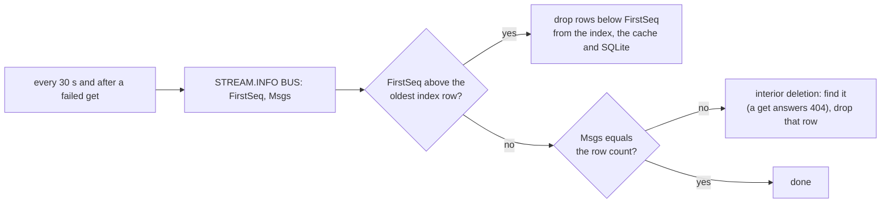
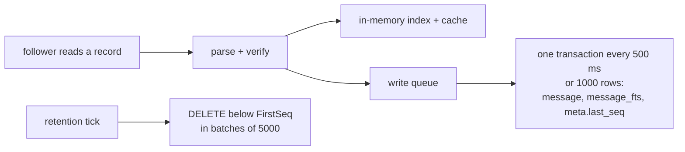

# Lazy monitor: an index in memory, bodies on demand

[Design index](README.md) | related: [monitor and API](monitor-and-api.md), [JetStream binding](jetstream-binding.md)

| Part | Status |
|---|---|
| Today: the monitor reads all of stream `BUS` into memory and never drops a message | implemented (MVP) |
| Index in memory, bodies read from the stream on demand, retention followed | **proposed** |
| Search on a SQLite FTS index | **proposed** (the monitor guide already names it as planned) |
| Backward paging (`before`), server-side unread counts, infinite scroll in both clients | **proposed** |

**Accepted, not built.** The owner agreed to the direction and to the decisions below; the
numbers are measured.

## The problem

The monitor (`internal/monitor`) reads every channel from its first message when it starts, keeps
each message twice in memory (the parsed fields and the stored record, `Message.raw`) and never
removes one. Two things follow:

- Memory grows with every message while it runs, also after the stream's retention (90 days or
  1 GiB by default) has deleted the message from the stream.
- After a restart the monitor holds about twice the size of the stream. At the 1 GiB limit that is
  about 2 GiB of heap, and the start has to read all of it before the view is complete.

Measured with the spike below (200 000 messages, 195 MiB in the stream): **2100 bytes of heap per
message**, 401 MiB in all; a full read with parsing and signature checks takes 16 s.

The clients already page (`GET /api/v1/messages?channel=&after=&limit=`, "Load older messages"),
so the server holding everything is no longer needed for the view. The target is the Slack model:
the server keeps a small index and a cache of recent bodies, and reads older pages from the stream
when a client scrolls back.

## The key question: reading a page of one channel from the stream

Stream `BUS` stores subjects `general`, `topic.<name>` and `dm.<recipient token>`. A group channel
and `general` are one subject each. A DM channel is the conversation of two agents, but the stream
has no such subject: `dm.<A>` holds everything sent **to A by anyone**, and the sender is only in
the signed record, not in a header. So "the messages of one DM channel" is not a subject filter,
for any read path. Only an index that knows each message's sender can name the right messages.

### The spike

A throwaway Go program (appendix) starts the pinned `nats-server` v2.15.3 with a file store, fills
a stream shaped like `BUS` and times the read paths with `nats.go` v1.56.0 on one machine over
loopback.

| Property | Value |
|---|---|
| Messages | 200 000 real signed envelopes (`envelope.Sign`), about 1 KiB each, 195 MiB in the stream |
| Subjects | 50: `general` (20 % of the traffic), 9 groups (55 %, skewed), 40 `dm.*` (25 %, a few hot pairs) |
| Pages | 50 messages from the middle of the history (stream sequence about 100 000 of 200 000), median of 15 runs |

| Read path | group channel | `general` | DM (two subjects) | Needs |
|---|---|---|---|---|
| A. Ordered consumer with the channel's subject filter, `DeliverByStartSequence`, walking back in windows of 1000 stream sequences | 5.0 ms | 7.9 ms | 19 ms (window 1000), 16 ms (5000) | nothing new; parses every message of the subject, also other senders' DMs; cost grows with sparsity |
| B. Index gives the 50 sequences; 50 sequential direct gets by sequence | 1.3 ms | 1.3 ms | 1.2 ms | direct get grant |
| **C. Same, 50 concurrent gets** | **0.28 ms** | **0.30 ms** | **0.27 ms** | direct get grant |
| C2. Same, pipelined on one subscription | 0.23 ms | 0.24 ms | 0.25 ms | direct get grant |
| D. Same, 50 concurrent `STREAM.MSG.GET` (the non-direct API) | 0.93 ms | 0.88 ms | 0.80 ms | `MSG.GET` grant only; no stream change |
| E. Batch direct get from the page's first sequence, `next_by_subj`, one request per subject | 0.60 ms | 0.41 ms | 1.2 ms for 100 messages, of which about half are other senders' | direct get grant; no filter by sender |

What the probes of the request forms on v2.15.3 showed (`DIRECT.GET` with `last_by_subj`,
`next_by_subj`, `multi_last`, `up_to_seq`, `batch`):

| Request | Result |
|---|---|
| `last_by_subj` (with or without `up_to_seq`) | one message: the last of the subject; `up_to_seq` is ignored |
| `seq` + `next_by_subj` | the first message of the subject at or after `seq` |
| `seq` + `next_by_subj` + `batch` | up to `batch` following messages, then `204 EOB` (path E) |
| `multi_last` + `up_to_seq` | the last message of **each** subject up to the sequence, one per subject |

So there is **no server-side "N messages before S" for a subject**: batch reads go forward, and
`multi_last` returns one message per subject. A backward page by subject needs path A (windows) or
a starting sequence taken from somewhere else.

A random single message deep in the stream (the by-id case, cold in the page cache of the server)
costs 0.55 ms for one direct get; neighbouring messages are cheaper because they share a file block.

### Decision: the index names the sequences, the page is N concurrent gets

Path C wins on every channel kind, and the only one that handles a DM correctly: an index row per
message already holds channel, sender and sequence, so the page is "the 50 index rows of this
channel before S", then 50 gets by sequence. It costs 0.3 ms (path D: 0.9 ms) and does not depend
on how sparse the channel is. Path A would remain as the **rebuild and fallback** read, but it is
not needed for paging.

Which API to call is a rollout detail, not a design one: `jetstream.Stream.GetMsg` in `nats.go`
uses direct get when the stream has `AllowDirect` and `STREAM.MSG.GET` otherwise. `BUS` does not
set `AllowDirect` today and the monitor's `monitor-bus` login may use neither; the grants
(`monitorBusPermissions` in `internal/broker/authconf.go`) get `$JS.API.STREAM.MSG.GET.BUS` and
`$JS.API.DIRECT.GET.BUS.>`, and `AllowDirect` is turned on later by `agent-busctl init` if the
extra 0.6 ms matters (it does not for paging).

A message the stream has deleted answers `404`; the monitor treats it as retention (below).

## The index

One row per message, built from the parsed record, without the body:

| Field | Type | Used for |
|---|---|---|
| `seq` | uint64 | the key; direct get; paging; read markers |
| `channel` | interned id | channel lists, paging, counts |
| `id` | 16 bytes (the ULID decoded) | by-id lookup, `reply_to` previews |
| `reply_to` | 16 bytes, zero for none | previews, thread view |
| `thread` | interned id | thread view |
| `from`, `to` | interned name | filters, display |
| `targets` | interned names, in a shared pool | mentions, targeted unread, notifications |
| `ts` | unix ms | display, search sort and `after:` / `before:` |
| `type`, `status` | one byte each | filters, verification badge |

The verification status is stored with the row. Today it is computed when the message arrives and
not revisited; that does not change.

Not in the index: title, text, refs (the body), `reason` of a rejected message (kept in the SQLite
table, read when a message is shown), `raw` (read from the stream).

Built over the same 200 000 messages: **192 bytes per message, 36 MiB** (row 72 bytes, the rest
is the by-id map, the per-channel position lists and the interning tables), against 2100 bytes
today. A by-id lookup in the map takes 86 ns. At the 1 GiB limit (about a million messages) that
is about 190 MiB. The figure is an upper bound: the spike gave every message its own thread, so
the thread table is larger than in real traffic.

If that is still too much, the by-id map (about a third) can move into the SQLite table (below).
Not needed to start.

### Building it at start

A headers-only consumer (`HeadersOnly`) reads all 200 000 messages in **0.26 s** but gets nothing
useful: the stored headers are only `Nats-Msg-Id` (`<subject>/<envelope id>`), so the sender,
targets, thread, reply and type are not in them. Rows can be built without reading bodies only if
agents publish those fields as headers, which is a protocol change and does not help the messages
already stored. So the **first** build needs one full pass (16 s for 200 000 messages, of which 8 s
is the signature checks; about 80 s at the 1 GiB limit).

That pass happens once. The SQLite file (below) keeps the rows: a restart loads them (0.16 s for
200 000 rows measured) and reads only the stream after its last sequence.

## The cache

| Question | Answer |
|---|---|
| What is cached | parsed bodies (title, text, refs, reason), keyed by sequence; not `raw` |
| Size | a byte bound, `--cache-size` (default 64 MiB, about 60 000 messages at 1 KiB) |
| Eviction | least recently used |
| Filled by | live messages as they arrive (the open channels need them at once); page reads; by-id reads |
| Not cached | raw views (a single read from the stream; rare) |
| Concurrency | concurrent requests for the same missing sequence share one read |

A stream read that fails (broker down) answers `503` with the existing `bus: reconnecting` status
and does not evict anything.

## How retention is followed

Limit-based retention (`MaxAge`, `MaxBytes`) removes from the front of the stream, so the first
sequence is the boundary.



- The monitor already holds `STREAM.INFO BUS`. No advisory is relied on: the monitor does not
  subscribe to the server's advisories, and a poll is simpler and enough (30 s of lag is harmless). A purge or delete by hand is caught by the count check and by
  the `404` of a get.
- The rows are a sorted array by sequence, so dropping the front is a slice cut plus removing the
  by-id entries and the front of each channel list.
- A `404` on a page read drops that row at once and the page is filled from the next older row.
- `Channel.messages` and `last_sequence` come from the index, so counts shrink with retention.

## API and client changes

| Change | Why |
|---|---|
| `GET /api/v1/messages?channel=&before=<seq>&limit=<n>`: the `n` messages before a sequence, **oldest first** within the page, same message shape. `after` stays | The clients' `after = covered - OLDER_WINDOW` windows guess in sequence space; a sparse channel returns nothing and the extension needs a capped loop (`OLDER_STEPS`). `before` returns exactly a page |
| `GET /api/v1/messages/by-id` | already planned by the other change; the index answers it |
| Channels: `unread` and `targeted_unread` counts, computed from the index and the shared read markers | Both clients count unread from the messages they hold (`unreadMessages` in the extension, `state.unread` on the web page). With lazy loading they hold only a tail, so the counts must come from the server |
| Search: unchanged endpoint, syntax and cursor | below |
| `Message` JSON | unchanged; `raw` is not part of it |

Clients, both in step (web `internal/monitor/web/index.html`, extension `vscode/src`):

- **Infinite scroll up.** When the top of the message list nears the viewport, call `before` with
  the oldest loaded sequence; keep the scroll position (add the new height); stop when a page comes
  back shorter than `limit`. The "Load older messages" button stays as the fallback for a failed
  load. In the extension the webview asks the model (`model.loadOlder`), as the button does now.
- A message opened from search or a notification that is not loaded: load its page by
  `by-id`/`before` instead of the `loadOlder` loop in `chat.ts`.
- Unread badges read the server's counts, not the loaded list.

## Search on SQLite FTS

The endpoint scans messages in memory today. The text must come from the bodies, which the server
no longer keeps, so search moves to an index on disk.

### The driver

The build is `CGO_ENABLED=0` (`.goreleaser.yaml`), so the driver has to be pure Go.
**`modernc.org/sqlite` v1.63.0** (the SQLite C source transpiled to Go): BSD-3-Clause, with
dependencies under BSD-3 and MIT (`modernc.org/libc`, `mathutil`, `memory`, `go-humanize`,
`go-strftime`, `go-isatty`, `google/uuid`, `bigfft`, `golang.org/x/sys`). FTS5 is built in. In the
spike it built with `CGO_ENABLED=0` and adds **6.5 MB** to a stripped binary. Its speed is lower
than the C library but the numbers below are far from a limit.

### Schema

One file, `monitor-web/index.sqlite` next to `prefs.json`. It is a **cache**: the stream is the
source of truth, and a lost or unreadable file is rebuilt.

```sql
CREATE TABLE meta (key TEXT PRIMARY KEY, value TEXT) WITHOUT ROWID;   -- schema version, last indexed seq

CREATE TABLE message (               -- the index rows above, so a restart does not read the stream
  seq INTEGER PRIMARY KEY, channel TEXT NOT NULL, id BLOB NOT NULL, reply_to BLOB, thread TEXT,
  from_agent TEXT, to_name TEXT, targets TEXT, ts INTEGER, type TEXT, status TEXT, reason TEXT
) WITHOUT ROWID;

CREATE VIRTUAL TABLE message_fts USING fts5(
  title, text, refs, content = '', contentless_delete = 1,
  tokenize = 'unicode61 remove_diacritics 2'
);                                   -- rowid = message.seq
```

`content = ''` stores no text: the index is the only copy kept, and a hit is a sequence, resolved
through the in-memory index and the cache or one get. `contentless_delete = 1` allows deleting a
row by rowid.

### A query

The syntax is the one in `docs/monitor.md`. The terms that are words or phrases go to `MATCH`;
`from:`, `to:`, `targets:`, `type:`, `has:target`, `after:` and `before:` are checked against the
index rows (in memory, no SQL). Candidates come newest first; the filters drop rows; the cursor is
unchanged. A query with no text terms never touches FTS: it walks the in-memory rows.

Measured on 200 000 messages (about 840 bytes of text each, 5000-word vocabulary), 50 newest hits:

| Query | Time |
|---|---|
| one common word | 0.4 to 1.0 ms |
| two words | 0.4 ms |
| a phrase | 1.6 ms |
| a rare word | 0.1 ms |

The FTS index of 200 000 messages is 119 MiB on disk (about 0.7 times the text) and took 10 s to
fill, 20 000 rows per second in one transaction. The `message` table costs another 0.5 s to write
and 0.16 s to read back.

### Keeping it in step



- A single writer goroutine owns the write connection (WAL mode, `synchronous = NORMAL`); readers
  use their own.
- `meta.last_seq` is written in the same transaction as the rows, so a crash leaves the file and
  the pointer consistent. At start the monitor loads `message`, then reads the stream from
  `last_seq + 1`.
- Deleting 50 000 rows took 2.5 s; the writer deletes in batches of 5000 so a request is never
  held that long (SQLite serves readers in WAL mode while it writes).

### Rebuild

If the file is missing, has another `meta.schema` version, or fails `PRAGMA quick_check`, the
monitor starts with an empty index and does one full pass from `FirstSeq` (16 s per 200 000
messages, FTS filling in step). Channels and live messages work during the pass with what has been
read; search answers `503 indexing` with a progress figure until the pass ends. A schema change in
a release is a rebuild, not a migration.

## Migration and rollout

- Nothing in the stream, the bus or the agents changes. The monitor is the only consumer.
- First start of the new monitor: one full pass (as today's start), then the SQLite file is there.
  Later starts take seconds.
- The two grants in `monitorBusPermissions` need a regenerated authorization file and a reload,
  which `agent-busctl` and the deploy already do (the monitor reconnects; the grants are additive).
  Order: ship the grants first, then the monitor; a new monitor without the grants falls back to
  reading pages with path A (slower, correct) and reports it once.
- The data directory of the monitor needs room for the file: about 0.7 times the text plus 40 bytes
  of row per message, so roughly 130 MiB per 200 000 messages. The container volume that holds
  `prefs.json` already persists; on a read-only root filesystem the path must be writable.
- Old clients keep working: `after`, the message shape and search do not change. They show the
  older windows through `after` as before, only without the unread counts for channels they have
  not loaded; the clients and the monitor are released together in one version.

## Risks

| Risk | Answer |
|---|---|
| The index and the stream disagree (a purge, a restore, a stream recreated with lower sequences) | `Msgs` check and the `404` rule; if the stream's last sequence is below `meta.last_seq`, drop the file and rebuild |
| A restore into a stream with new sequence numbers | same: detected by last sequence going back; the rebuild is the repair |
| First start on a large stream is long | as today; the view works while it reads; progress in `status` |
| Cold random reads on a large stream are slower than 0.3 ms (0.55 ms measured on a warm machine; a cold disk costs more) | one page is one batch of parallel gets; the cache hides repeats |
| The pure-Go SQLite is slower or has its own bugs | the file is a cache, rebuilt on any failure; `quick_check` at start; the in-memory path for non-text queries does not depend on it |
| Binary and dependency growth (+6.5 MB, nine small modules, all BSD or MIT) | accepted for the sake of a single static binary |
| Grants: `STREAM.MSG.GET.BUS` and `DIRECT.GET.BUS.>` let the monitor read any message of `BUS` by sequence | it already reads every message (`CONSUMER.CREATE` on `BUS`); nothing new is exposed. Both are read-only subjects |
| Live messages and a page read racing (a message arrives while a page is built) | the page is cut at a sequence taken under the lock; live messages above it come through the event stream, as now |
| The write queue grows when SQLite is slow | bounded queue; when full, the follower waits (back pressure), the in-memory index is not behind |

## Step plan

Each step is one commit with its tests and docs, and passes `make check` on its own.

1. **Split `Message` from the index row.** *Built.* The row type, the interning tables and the
   by-id lookup (`GET /messages/by-id` and its `Monitor.byID` came after this note was written, so
   the index row took it over). The row has no `reply_to` yet: nothing reads it until the thread
   view moves to the server, and the previews fetch parents by `id`. The reason a message was not
   verified is kept in a small map by sequence, to move into the SQLite table in step 7.
2. **Read a body from the stream by sequence.** *Built.* `bus.Transport.Message(ctx, seq)`, the
   `STREAM.MSG.GET.BUS` grant, an integration test against the pinned server. The concurrent page
   read lives with the cache in step 3, since it is the monitor's logic.
3. **Serve from the index and the cache.** *Built.* `Messages`, `MessageByID`, `RawMessage`,
   `Channels` (counts, last sequence) and search read the index; bodies come through the LRU
   cache (`--cache-size`) and, on a miss, up to 32 concurrent gets; `Message.raw` and the
   per-channel `Message` slices are gone. Search still scans: it filters on the index and reads the
   bodies of the candidates newest first, which is slow on a big history until step 8. Memory test:
   heap per message.
4. **`before` on `/messages`**, in `docs/api.md` and `docs/openapi.yaml`. *Built.* `after` and
   `before` together are a `400`; the newest page is `before=<last_sequence + 1>`.
5. **Follow retention.** The `FirstSeq` tick, the `404` rule, the count check; integration test with
   a short `MaxAge` or `MaxBytes` stream (`internal/itest/retention_test.go` has the setup).
6. **Unread counts on the server** (`unread`, `targeted_unread` in `/channels`) and clients using
   them; the same step for both clients.
7. **SQLite store.** The driver, the file, the `message` table, load at start and read from
   `last_seq + 1`; rebuild on a missing or bad file.
8. **FTS and search.** `message_fts`, the writer, the query path behind the existing endpoint, the
   deletions with retention, rebuild with the `indexing` status; the scan in `search.go` is removed.
9. **Infinite scroll**, web page and extension in one change (or two adjacent commits that land
   together), using `before`.
10. **Docs and cleanup.** `docs/monitor.md` (limits of the MVP, search), the status tables in this
    index and in [monitor and API](monitor-and-api.md); this document moves from proposed to
    implemented.

Steps 1 to 3 give the memory win alone. Step 6 has to land before step 9, and 3 before 6.

## Decisions (owner, 2026-11-26)

1. `bus-monitor` keeps a state file (`monitor-web/index.sqlite`, rebuilt when lost) and grows by
   about 6.5 MB for the pure-Go SQLite.
2. The first start reads the whole stream once (about 16 s per 200 000 messages); the monitor
   serves the newest messages while it builds. Agents publish no extra NATS headers.
3. The body cache defaults to 64 MiB.
4. Unread counts and notifications keep working across a restart from the read markers in
   `prefs.json`, as planned; the server computes the counts (`/channels`), because a client that
   holds only a tail cannot.
5. Pages are read with `STREAM.MSG.GET`; `BUS` keeps `AllowDirect` off. Direct get stays an option
   if pages ever get slow.

## Appendix: the spike

Throwaway programs, not in the repository. They live in
`~/.cache/agent-messenger-work/lazy-monitor/` (`zspike/` for the stream, `sqlitespike/` for SQLite,
`result.txt` for the output). The stream spike imports the repository's `envelope` and `bus`
packages, so it has to sit under `internal/` of this module to build:
`go run ./internal/zspike <scratch dir> bin/nats-server`.

What it does:

1. Starts `nats-server -js`, creates stream `BUS` (`dm.>`, `general`, `topic.>`, `private.>`,
   file storage, `AllowDirect`).
2. Publishes 200 000 signed envelopes with `PublishAsync`, over `general`, 9 groups and 40 DM
   subjects, with replies and 1 to 2 targets each.
3. Builds the index with one ordered consumer (parse, verify, intern), and measures the heap before
   and after with `runtime.ReadMemStats`, once with today's `Message` plus `raw` kept for the
   comparison and once without.
4. Reads the stream again with `HeadersOnly`.
5. Times the read paths A to E and the request probes of the table above.

Raw output of the run:

```text
fill: 200000 msgs in 10s, stream 195 MiB, 50 subjects
index build, full pass with bodies (parse + verify + index + keep today's copy): 16.175s (verify alone 8.358s)
memory: today's Message+raw 2103 B/msg (401 MiB); index 192 B/msg (36 MiB)
headers-only pass: 257ms (payload bytes received 0)
by-id index lookup: 86ns per lookup
by-id lookup + one direct get of the body: 554µs per message
```

The machine was a desktop running the server and the spike on loopback, with the data in the page
cache. Absolute times will differ on the deployment host; the ratios between the paths and the
bytes per message will not.
