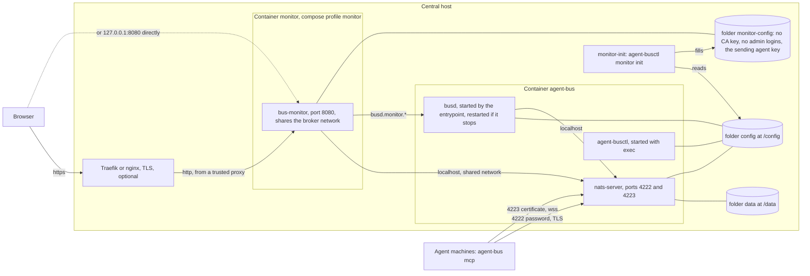
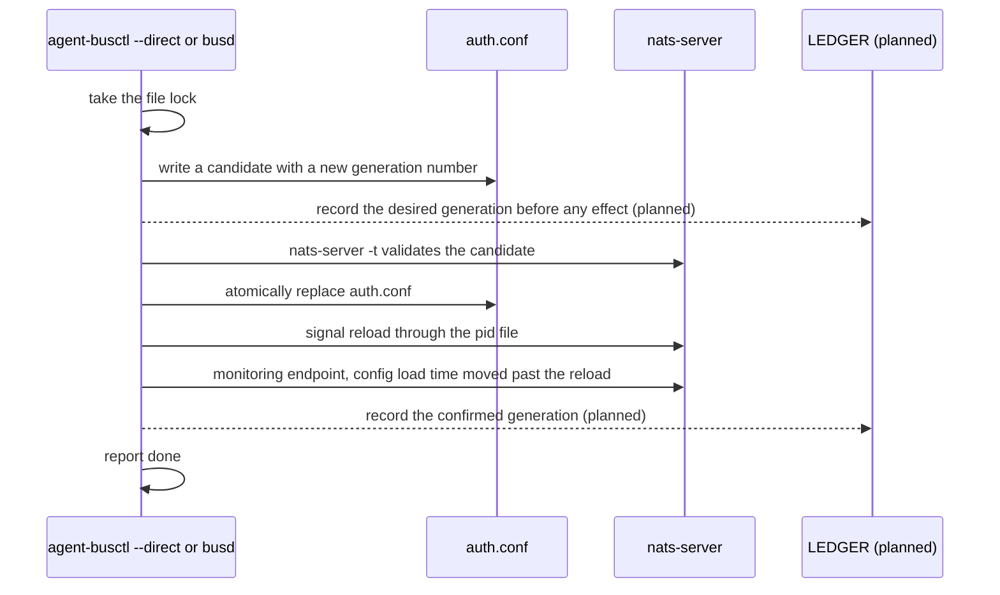

# Operations and deployment

[Design index](README.md) | previous: [monitor and API](monitor-and-api.md) | next: [milestones](milestones.md)

How the broker is run, how permission changes reach it (the confirmed reload), and how the pieces
are deployed and released. The step-by-step guides are the user documentation:
[docs/docker.md](../docker.md), [docs/podman.md](../podman.md), [docs/broker.md](../broker.md),
[docs/development.md](../development.md).

| Part | Status |
|---|---|
| `nats-server` as its own process, `deploy/nats-server.conf`, `deploy/nats.sh`, generated `auth.conf` and `control-auth.conf` | implemented |
| Confirmed reload (lock, candidate, validate, replace, signal, confirm) | implemented in `agent-busctl --direct` and in busd (enrollment approvals); the **generation numbers recorded in the ledger and crash recovery by busd** are **planned** |
| One image with `nats-server`, `busd`, `agent-busctl`, `agent-bus`, `bus-monitor`; compose files, Podman scripts (`deploy/podman/start.sh`, `monitor.sh`); reverse-proxy samples in `deploy/proxy/`; release by tag (archives and image) | implemented (this replaced the Pod manifest of the original plan, decisions 15 and 31) |
| busd as a supervised service | minimal busd runs in the broker container, restarted by an entrypoint loop; systemd-style supervision **planned** |

## Deployment

The ports are 4222 (password login), 4223 (certificate login, `wss://`) and the monitor's 8080
(`127.0.0.1` by default, a TLS reverse proxy for anything else). nats-server's own monitoring
endpoint (8222) stays inside the container.

## Server configuration and reload

`nats-server.conf` holds the static settings: listener, TLS, the two accounts, the JetStream store
directory and a local monitoring endpoint. It includes the generated `auth.conf` (the users and
permissions of `BUS`) and `control-auth.conf`. busd and `agent-busctl --direct` are the only
writers.

A change is one serialised operation. Only then is the change reported done:

1. Take the file lock.
2. Write a candidate file with a new generation number.
3. Validate it (`nats-server -t`).
4. Atomically replace `auth.conf`.
5. Reload (`nats-server --signal reload` with the pid file).
6. Confirm that the server loaded it (the monitoring endpoint's config load time moves past the
   reload).

What a reload does:

- It changes the permissions of live connections: a revoked grant removes the subscription at
  once, and removing a user disconnects it.
- Because the server is a separate process, a busd crash or restart drops no agent connection.
- busd and `nats-server` run on the same host. Reloads go through the broker's container only;
  the monitor container never signals ([docs/broker.md](../broker.md)).

**Built:** the generation number is written into the auth file, and the reload is confirmed
before a change is reported done, in `agent-busctl --direct` and in busd's enrollment approvals.

**Planned:**

- The ledger records the desired and the confirmed generation, so after a crash busd finishes an
  unconfirmed reload before anything else.
- Consumer cleanup (deleting a member's consumers, which cancels waiting pulls) becomes part of
  finishing a revocation.
- Reconciliation ([private channels](private-channels.md)) reads the confirmed generation, not
  just the file.

## Images and processes

One image holds `nats-server`, `busd`, `agent-busctl`, `bus-monitor` and `agent-bus`. The
[deployment diagram](#deployment) shows how the containers fit together.

- **Broker container.** Its entrypoint renders the server configuration (`deploy/nats-server.conf`;
  `auth.conf` is generated, mode 0600) and starts busd beside it in a restart loop where the config
  folder has `ca.key` (`BUS_BUSD=off` skips it). It runs `nats-server` as the main process, so
  signals reach it and `agent-busctl --direct` can reload it.
- **Monitor container.** The same image, with a config folder of its own. `monitor-init` fills it
  from the broker's config, which it only reads (the config also holds the sending agent's key
  when `--agent` is given). The Podman scripts `deploy/podman/start.sh` and `monitor.sh` do the same
  with bind mounts.
- **How to run it.** The compose file in `deploy/` or the Podman scripts in `deploy/podman/`. A plain
  `nats-server` binary with the start script is for development and tests only
  ([docs/development.md](../development.md)). Nothing in the Go code or agent-busctl depends on how
  the processes start.
- **No high availability.** [busd](busd.md) says what works while busd is down.

> **Superseded in part:** the broker is run from the Docker image, not from a Pod manifest
> (decisions 15 and 31).

## Backup and restore

The step-by-step procedures are user documentation ([docs/docker.md](../docker.md#upgrade),
[docs/podman.md](../podman.md)). Design points:

- The state is the config folder (`/config`: CA, credentials, `auth.conf`, busd's `enroll/` state)
  and the data folder (`/data`: the JetStream store).
- After restoring busd's config folder from a backup, delete `enroll/directory.json` so busd starts
  a new directory epoch ([directory v2](directory-v2.md#failures-and-recovery)).
- Planned: ledger backup and restore, with `busd reconcile --adopt`
  ([private channels](private-channels.md)).

## Releases

A tag `v*` publishes the archives, `checksums.txt` and the changelog as a GitHub release and pushes
the image to `ghcr.io`; every push to `main` runs `make check` and a snapshot build that publishes
nothing. The procedure is in [docs/development.md](../development.md#cutting-a-release). `make check`
(gofmt, vet, unit tests) needs no broker; `make itest` runs the integration tests against a real
`nats-server`.

## See also

- [Access control](access-control.md): the two listeners, enrollment and the reload topology (busd reloads inside the broker container).
- [JetStream binding](jetstream-binding.md): what the configuration contains.
