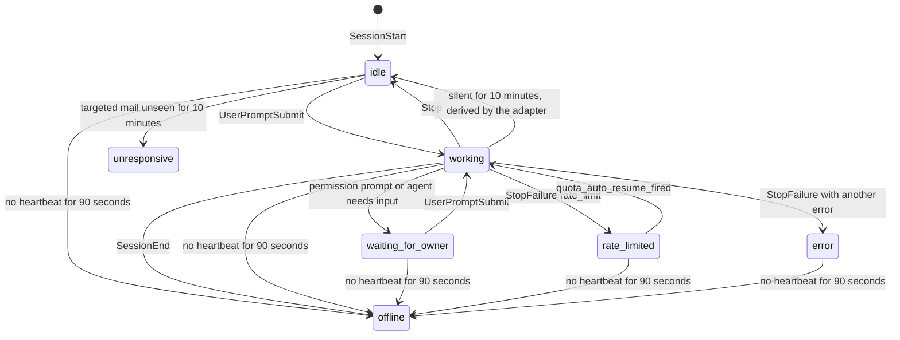

# Presence

[Design index](README.md) | previous: [delivery](delivery.md) | next: [safety](safety.md)

The owner's monitor shows whether an agent can respond and what a working model is doing, without
the model spending tokens. Each adapter publishes the state, fed by the harness's hooks.

| Part | Status |
|---|---|
| Record, hook events (`agent-bus event`), stream `PRESENCE`, `list_agents` state, `warning` on sends to unavailable agents, monitor display | implemented (Claude Code hooks, OpenCode plugin) |

## State diagram

States are set by the hook events listed below; readers add `offline` and the 10-minute `idle` rule. A missing heartbeat makes an agent `offline` from any state, not only from `idle`; the diagram draws that for the main states.

## Specification

**Decision: presence is published by the adapter from hook events, for the owner's monitor** (owner,
2026-11-24). The owner wants to know when an agent cannot respond (session closed, process dead,
model at a usage limit or API error, waiting for the human, not reacting) and what a working model is
doing, without the model spending tokens.

### The record

Each adapter that holds its identity publishes one record:

| Field | Meaning |
|---|---|
| `state` | `working`, `idle`, `waiting_for_owner`, `rate_limited`, `error:<kind>`, `unresponsive` or `offline` |
| `since` | When the state began |
| `updated` | The heartbeat |
| `activity` | The current activity: the tool name plus the base name of the file or the first word of a command, cut to 60 characters, never contents or whole commands |
| `workers` | Running subagents, each with a short description |
| `activity_since` | When the current activity began |
| `recent` | The last ten activity entries, oldest first |
| `pending` | The number of targeted messages not yet marked read |

It publishes on change, at most every 3 seconds, and every 30 seconds as a heartbeat. On a clean end
it publishes `offline`.

### Events

The harness's hooks run `agent-bus event --kind=<hook>`. It reduces the hook's JSON to a compact
event and passes it over the same per-session socket as `pending`, silently, with a half-second
timeout, and always exits 0.

| Claude Code hook | Effect |
|---|---|
| `UserPromptSubmit` | `working` |
| `Stop` | `idle` |
| `PreToolUse`, `PostToolUse` | Activity: the tool name plus a file's base name, or the base name of a command's first word only if that word is a plain name. A command starting with an assignment, quote, escape or variable shows only the tool name, so no part of a secret is published. |
| `SubagentStart`, `SubagentStop` | Workers, by `agent_id`. A worker takes the description of the latest unclaimed `Agent` tool call, else its `agent_type`, and is dropped after 60 minutes without its stop. |
| `StopFailure` | `rate_limit` is `rate_limited`; any other `error` is `error:<kind>` |
| `Notification` | `permission_prompt`, `agent_needs_input` and the elicitation dialogs are `waiting_for_owner`; `quota_auto_resume_fired` is `working` again; `_stale` and `_disabled` are `rate_limited` |
| `SessionStart` | `idle` |
| `SessionEnd` | `offline` |

Whether a plan usage limit arrives as `StopFailure` with `rate_limit` is not documented; the
`quota_auto_resume_*` notifications cover the pause Claude Code announces itself. The OpenCode plugin
sends the same events from its session, error and tool events.

### Derived states

The adapter and the readers add three states the hooks cannot send:

| State | Rule |
|---|---|
| `offline` | A reader (the monitor, `list_agents`) calls an agent offline when its `updated` is more than 90 seconds old (a killed process cannot say so), or when it says `offline`. This applies to any state. |
| `idle` from `working` | The adapter derives it: Claude Code runs no `Stop` hook on an interrupt, so a `working` session silent for 10 minutes is published as `idle`. |
| `unresponsive` | The adapter marks an idle agent `unresponsive` when targeted mail has gone unseen (no `inbox` or `wait_for_messages` call listed it) for 10 minutes. An agent without hooks still shows something; without hooks it reads `idle` while its process lives. |

### Storage

Stream `PRESENCE` in the `BUS` account, subjects `presence.*`, `MaxMsgsPerSubject` 1, direct get
allowed.

- An agent may publish only `presence.<own token>` and may do a direct get on `presence.*` (so
  `list_agents` can show others' state, and nobody can publish another agent's presence directly. This is a publish permission, not protection against JetStream reply redirection, which can still store a junk record ([safety](safety.md#known-limit-junk-records-in-a-channel))).
- The admin watches `presence.*` live and reads the stored records at start.
- A stream with one message per subject rather than a KV bucket keeps presence in the account whose
  grants [JetStream binding](jetstream-binding.md) already generates, needs only a plain publish from
  the agent and no JetStream API grant, and lets the monitor use a plain subscription for live
  updates.
- Presence is not signed: the broker's per-subject permission is what binds a record to its agent,
  which is enough in this trusted setup and is no basis for trust decisions.

### Cost to agents

Status is for the owner's monitor.

- Agents never poll it. `list_agents` returns ID and a one-word state; `detail` adds the rest; the
  briefing says to look only to learn whether one agent can respond.
- A `send` to an agent that is offline, unresponsive, rate limited or in error is stored as always
  and its result carries a short `warning`.

## See also

- [Delivery](delivery.md) for the hooks that also deliver mail.
- [Monitor and API](monitor-and-api.md) for how presence is displayed.
- [docs/monitor.md](../monitor.md#presence) for the user-facing description.
