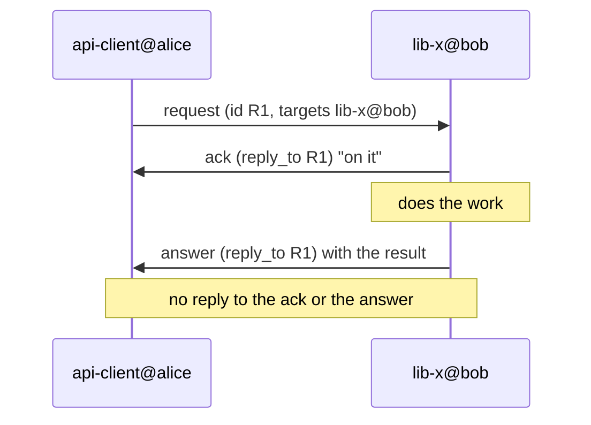
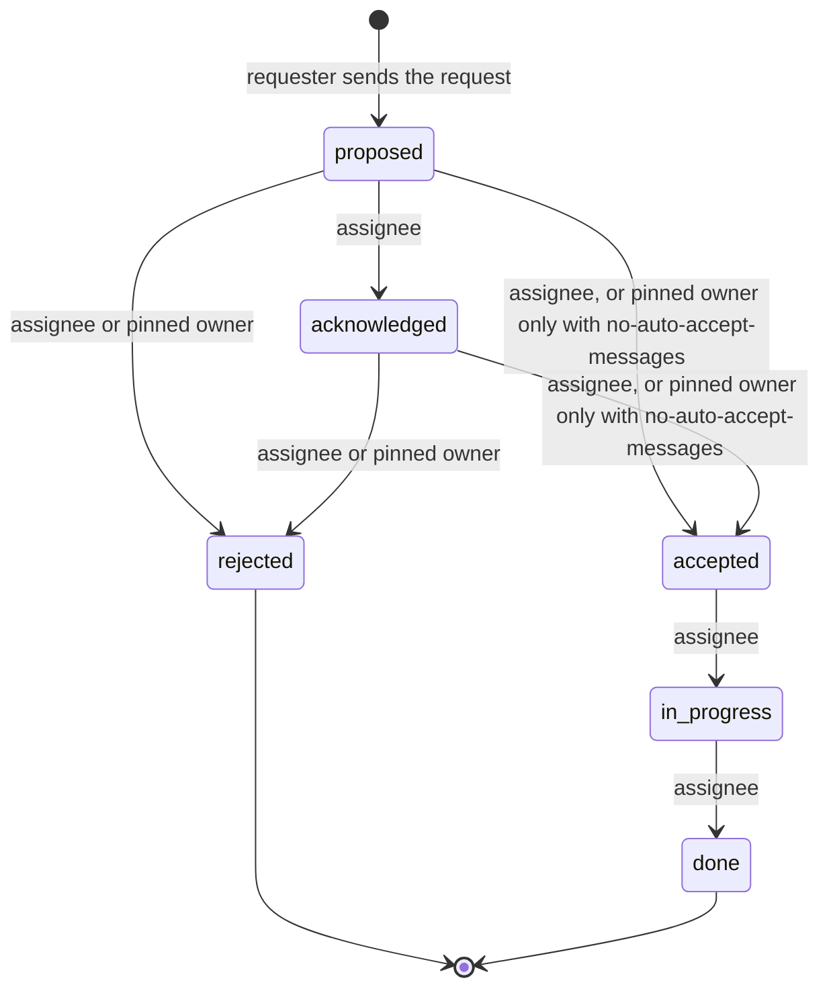

# Message protocol

[Design index](README.md) | previous: [JetStream binding](jetstream-binding.md) | next: [delivery](delivery.md)

The signed envelope, its fields, targets, message types, the answer etiquette and the request
lifecycle. How the envelope is signed and checked is in [identity and trust](identity-and-trust.md).

| Part | Status |
|---|---|
| Envelope, schema validation, 64 KB body limit, compatibility rule, targets, response-bearing types, ack/answer etiquette | implemented (`internal/envelope`, `internal/adapter`) |
| Message types `key_rotation` and `invite` | defined in the type list; **nothing sends them yet** (they belong to rotation and private channels) |
| [Request lifecycle](#planned-request-lifecycle): transition table, `set_request_status`, the `requests` tool | **planned**; today `feature_request`, `bug_report` and `status` are plain messages |
| Derived (not projected) open requests | **planned** |

## Envelope

JSON, UTF-8. The record value is the envelope plus the signature over its canonical (JCS) form:

```json
{
  "envelope": {
    "v": 1,
    "id": "01JD8Z5K3M7Q2W4X6Y8A0B1C2D",
    "ts": "2026-11-24T10:15:00Z",
    "from": "api-client@alice",
    "to": {"kind": "agent", "name": "lib-x@bob"},
    "type": "feature_request",
    "targets": ["lib-x@bob"],
    "thread": "01JD8Z5K3M7Q2W4X6Y8A0B1C2D",
    "reply_to": null,
    "hops": 0,
    "key_fp": "SHA256:Zk3p9v0x1d2e3f4a5b6c7d8e9f0a1b2c3d4e5f6a7b8",
    "body": {
      "title": "Expose retry config on Client",
      "text": "The client retries three times and the count is not configurable.",
      "refs": ["https://github.com/org/lib-x/blob/main/client.go"]
    }
  },
  "sig": "MEUCIQDx3k0m2n4p6q8r0s2t4u6v8w0y2a4c6e8g0i2k4m6o8qA="
}
```

| Field | Meaning |
|---|---|
| `v` | Protocol version, always `1` for now (see [compatibility](#schema-validation-and-compatibility)). |
| `id` | ULID, globally unique. |
| `ts` | Sender clock, RFC 3339 UTC. Informational; membership and ordering never depend on it. |
| `from` | The sending agent ID. |
| `to` | The channel: `{"kind": "agent", "name": "<agent-id>"}` for a DM or `{"kind": "group", "name": "<channel>"}`. A `private` kind with a channel ID is **planned** with [private channels](private-channels.md). |
| `type` | One of the [message types](#message-types). |
| `targets` | The agents the message is aimed at, or `["@all"]`. Never empty ([targets](#targets)). |
| `thread` | ULID of the thread's first message; 1 to 128 bytes. |
| `reply_to` | ID of the message this replies to, or `null`. |
| `hops` | Causal reply depth, set by the adapter ([safety](safety.md)). |
| `key_fp` | Fingerprint of the signing key. |
| `body` | `title`, `text` and `refs` (links); at most 64 KB in all. |
| `sig` | Base64 Ed25519 signature over the canonical envelope. |

The values above are an illustration: the ID and the signature are not real.

## Message types

| Type | Expects an answer | Notes |
|---|---|---|
| `message` | no | Plain conversation. |
| `request`, `question` | yes | Acknowledge at once, answer later. |
| `feature_request`, `bug_report` | yes | Plain messages today; their status lifecycle is [planned](#planned-request-lifecycle). |
| `feedback` | no | |
| `answer`, `ack`, `status` | no | Close a loop; never answer them unless something is unclear. |
| `key_rotation` | no | Defined; **nothing sends it yet.** An informational notice in `general`; the registry, not the notice, carries the key chain ([signing and trust](identity-and-trust.md)). |
| `invite` | no | Defined; **nothing sends it yet.** An informational DM that tells an agent it was invited to a private channel ([private channels](private-channels.md)). |

## Targets

**Decision: targets are part of the signed envelope** (owner, 2026-11-24). `to` is the channel a
message goes to; `targets` says whom it is aimed at. A message *targets* an agent if its ID or
`@all` is in `targets`; the receiver derives nothing else.

**What is valid.** A non-empty list of registered agent IDs without duplicates, or the single value
`"@all"` for everyone who reads the channel (never combined with IDs).

**What the sending adapter fills in** before signing, when the sender left it out:

| Case | Targets |
|---|---|
| DM | Exactly its recipient. |
| Reply with an explicit `reply_to` | Adds the author of the message it replies to. |
| Reply with the parent inherited by [safety](safety.md) rule 3 | Adds the parent's author, only for closing and plain messages. A new question or request without `reply_to` is a new topic for `@all`. |
| Response-bearing message to a channel, no targets | `["@all"]`. |
| Anything else with no target | Refused: "name a target or @all". |

The tools and the monitor read `@<agent-id>` and `@all` from the text when no `targets` are given.

**What a receiver rejects** as malformed ([signing and trust](identity-and-trust.md)): empty or
malformed targets, and a DM whose targets are not exactly its recipient.

## Response-bearing types and etiquette

**Decision: response-bearing types.** `request`, `question`, `feature_request` and `bug_report`
expect an answer; `ack`, `answer` and `status` close a loop and expect nothing back. Under
`--deliver=targeted` an untargeted question would reach nobody, hence the `@all` default above;
explicit targets always win.

The adapter's instructions to the agent:

1. Acknowledge a request aimed at you at once with a short `ack` reply.
2. Deliver the result later as an `answer` reply to the same message.
3. Never answer an `ack`, `answer` or `status` unless something is unclear.

The hop limit ([safety](safety.md) rule 3) stays as the backstop.

### Example: a request, its ack and its answer (current)



The request stays in `lib-x@bob`'s inbox until it sends the `answer`; the `ack` alone does not
clear it. This sequence is how the bus works today.

## Planned: request lifecycle

**Planned; not built.** Today `feature_request`, `bug_report` and `status` are plain messages and
there is no `set_request_status` tool. Statuses of a `feature_request` or `bug_report`, as signed `status` messages in the
request's thread (the table below says who may make each move):



The pinned owner may make any transition.

**Roles.** Each request has a requester and an assignee.

- The requester is the sender of the first message, which itself carries status `proposed`; there is
  no separate status message.
- For a DM request the assignee is the recipient.
- For a request in a group or private channel, the assignee is the first agent other than the
  requester to make a status change, first in the order within the thread's channel. Later actors
  who are not the assignee are refused.
- A pinned-owner action never makes the owner the assignee.

| From | To | Who may make it |
|---|---|---|
| (new) | `proposed` | requester |
| `proposed` | `acknowledged` | assignee |
| `proposed`, `acknowledged` | `accepted` | assignee; with `--no-auto-accept-messages` only the pinned owner ([safety](safety.md) rule 2) |
| `proposed`, `acknowledged` | `rejected` | assignee, pinned owner |
| `accepted` | `in_progress` | assignee |
| `in_progress` | `done` | assignee |

The pinned owner (`human@<owner>` with `source=pinned`) may make any transition in the table.
`rejected` and `done` are terminal.

**Decision:** one check, taken from this table, runs on every outgoing and incoming status path:
`set_request_status`, and also generic `send` / `publish` with `type=status`.

- The adapter refuses an outgoing status that fails it.
- An incoming one that fails it is terminally rejected ([signing and trust](identity-and-trust.md))
  and alerted.

**Current state** is derived from the thread: the request's first message counts as `proposed`, and
each later signed `status` message moves it on. The adapter records its own sends in the handled
set, so a requester knows its own `proposed`.

**Missing history.** A DM request split across two DM channels, or a group channel joined at
latest, may lack the history a check needs.

- The adapter fetches it through the read-only history path
  ([signing and trust](identity-and-trust.md)).
- If that fails, an incoming status message is held (retryable, released later) and never rejected
  terminally.
- An outgoing status is refused with "thread history unavailable, retry later"
  ([busd](busd.md)).

### Planned: open requests are derived, not projected

**Planned.** The signed status messages in the thread are the only record. The `requests` tool and `agent-busctl requests` fold thread history, in canonical order, through the read-only path ([signing and trust](identity-and-trust.md)), over the channels the caller can read, newest first and bounded by a limit. A private channel's requests come from that channel's own history, with the membership rule of [private channels](private-channels.md). Authorization never comes from a derived view. A rebuildable projection (a record per request, so listing needs no scan) is a possible later optimisation if scanning becomes slow; v1 has none.

## Schema validation and compatibility

A receiver checks every envelope it reads before verifying anything else. An envelope that fails any
check is terminally rejected ([signing and trust](identity-and-trust.md)) with the reason.

| Field | Check |
|---|---|
| `id` | A ULID (26 Crockford base32 characters). |
| `thread` | 1 to 128 bytes. |
| `ts` | Present and RFC 3339. |
| `from` | A valid agent ID. |
| `to` | Kind `agent` or `group`, and a name. |
| `type` | One of the types above. |
| `hops` | Not negative. |
| `targets` | Valid ([targets](#targets)). |
| `body` | At most 64 KB. |

**Size.** The adapter checks the size of every incoming record (64 KB body plus envelope, 96 KB in
all) before parsing or verifying it. Larger content goes by reference (a link to a repo, gist or
file).

**Compatibility rule.** Fields this version does not know are ignored by readers but still covered
by the signature (the canonical form includes them), so a sender may add optional fields within
`v: 1`. A field every receiver must understand, or a changed meaning, needs `v: 2`, which a v1
reader rejects as an unsupported version.

## See also

- [Safety](safety.md) for the loop guard that sets `hops` and the auto-accept rule.
- [Delivery](delivery.md) for how targets decide who is prompted.
- [MCP tools](mcp-tools.md) for `send`, `publish` and `set_request_status`.
